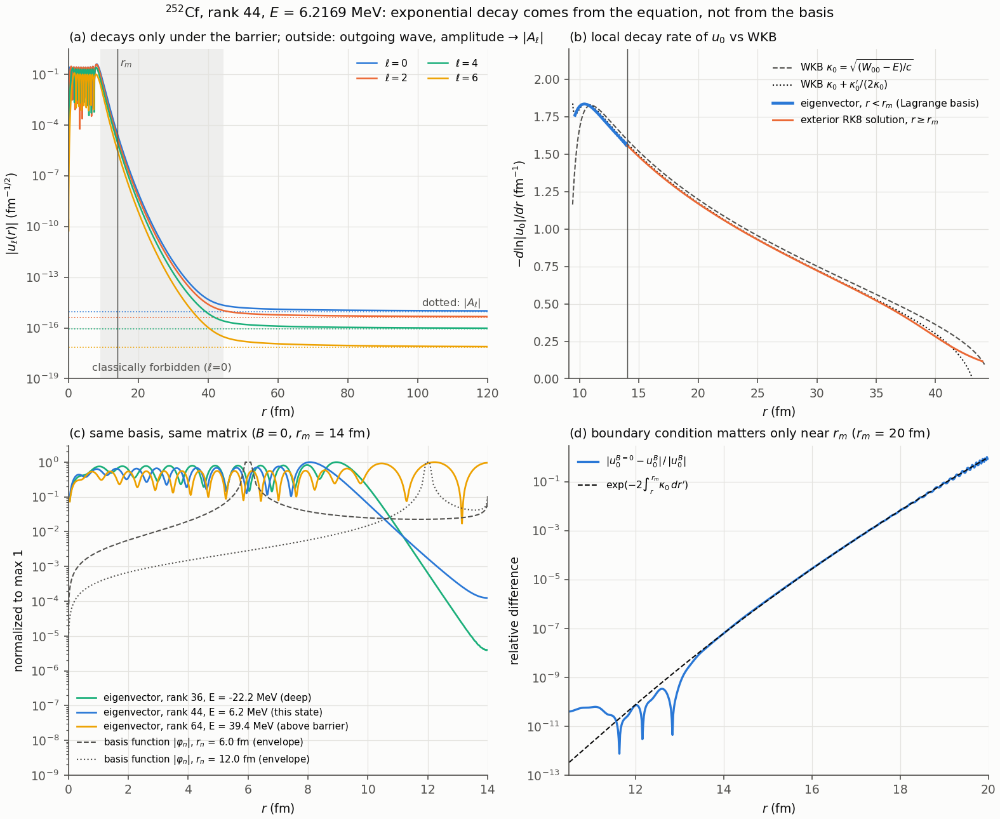
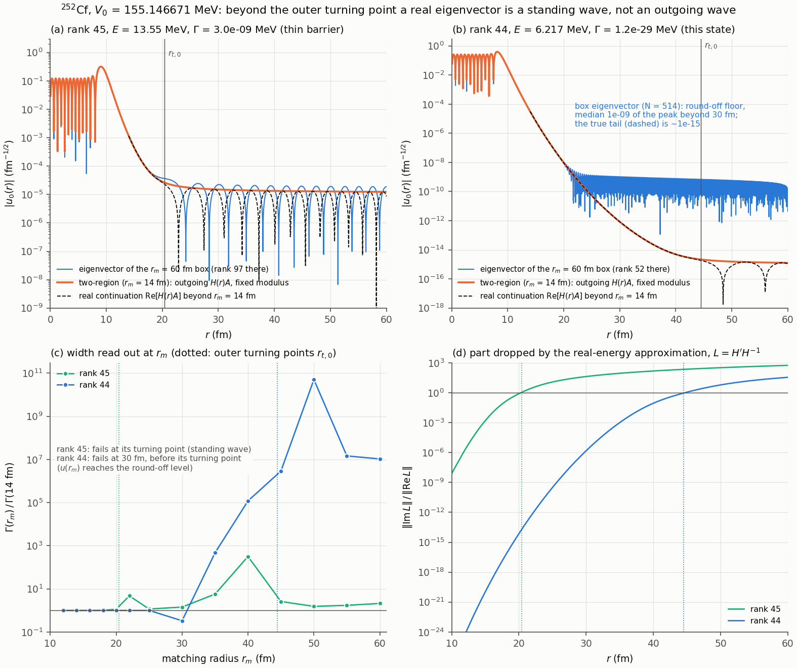
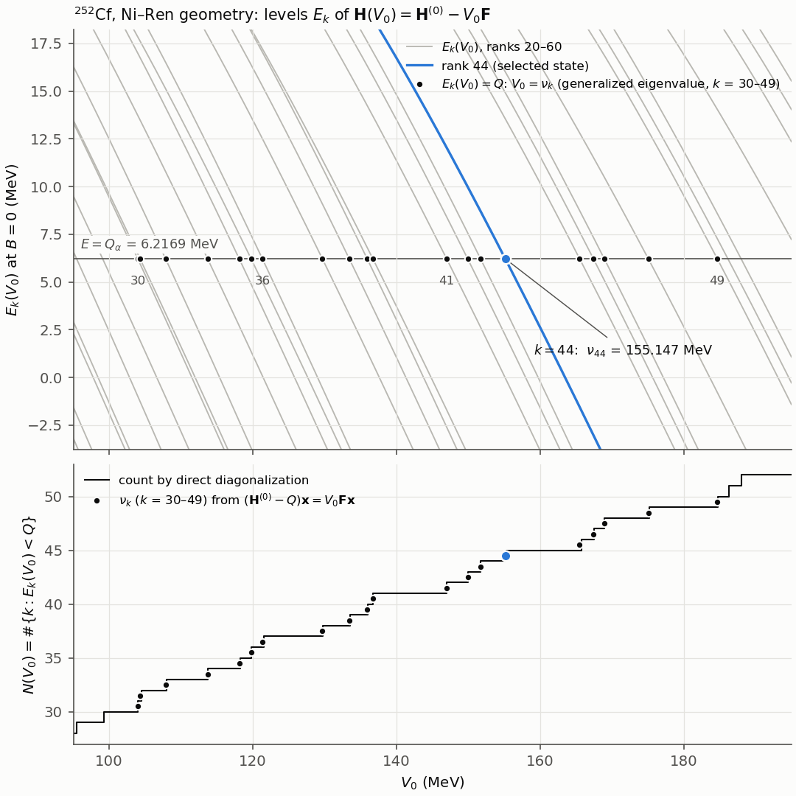
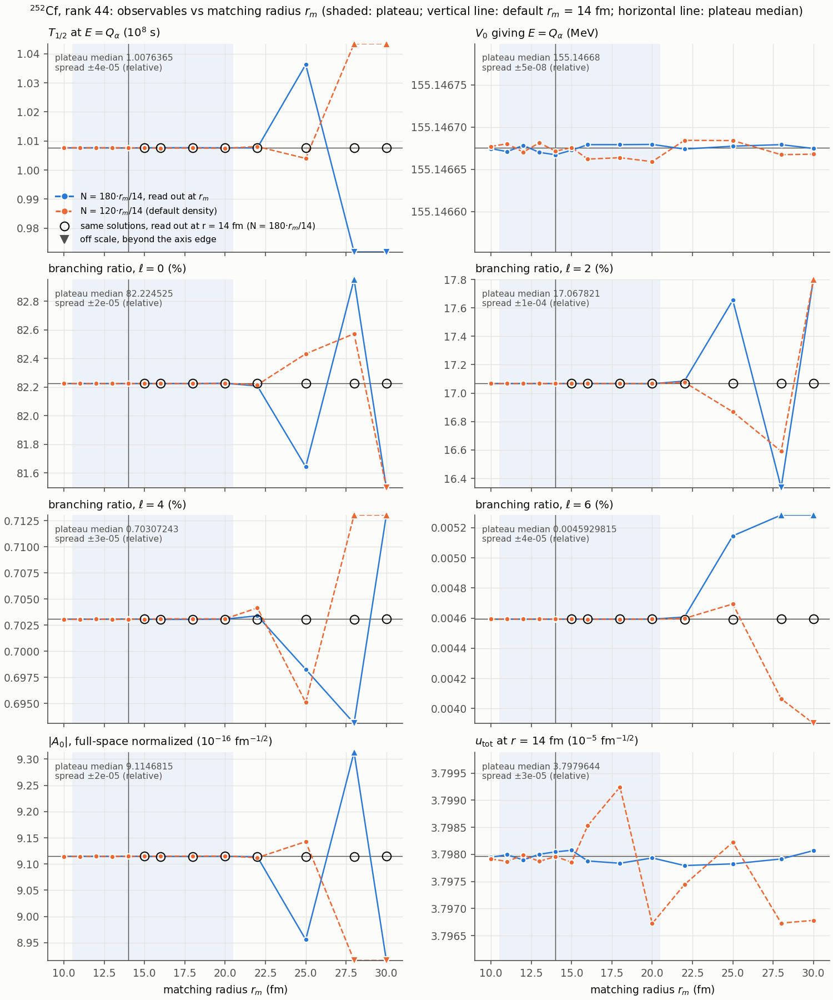
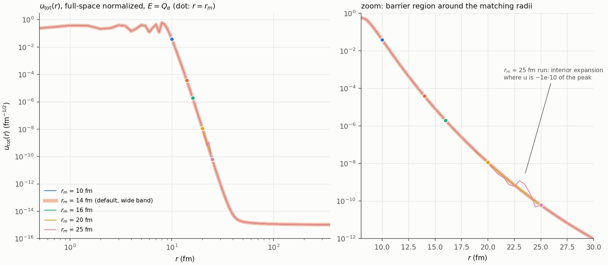
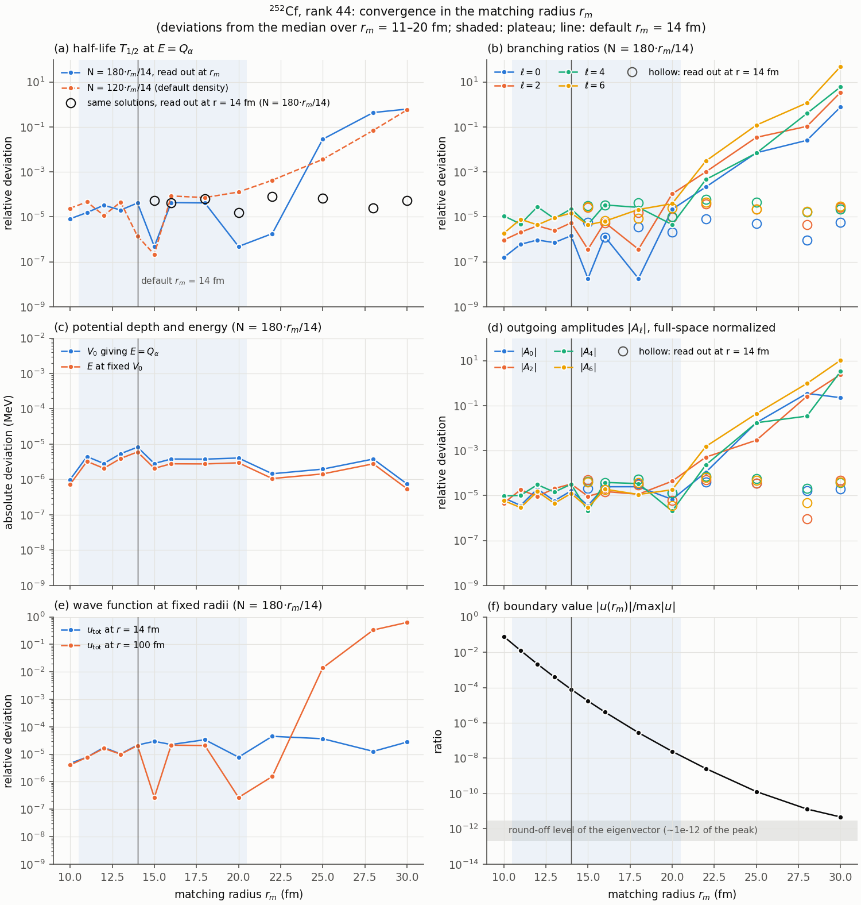
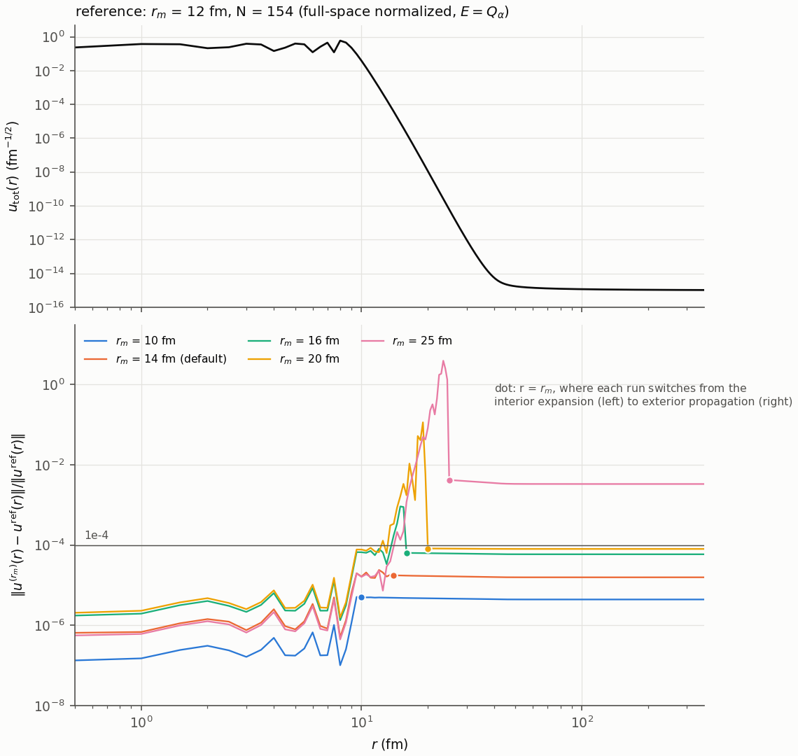
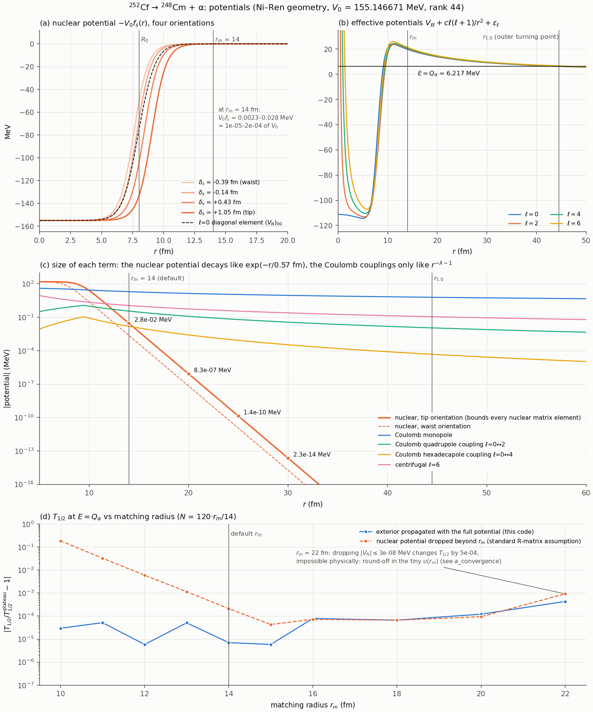

# ccrm.py 的公式与推导

本文按 `ccrm.py` 的计算顺序写出全部公式，并说明每一步的来由和数值做法。重点是第 6 节：判定共振态时求势深 $V_0$ 的方法，如何从原来“逐个位次迭代求本征值”改写为现在的“一次广义本征值问题”，以及两者为何严格等价。

- **对应代码：** `quasibound/ccrm.py`（2026-11-10 版本）。插图由 `docs/levels_vs_V0.py` 生成。
- **数值例子：** 全部取 252Cf → 248Cm + α，Ni–Ren 几何，默认数值参数（$N=120$，$r_m=14$ fm，$R_{\mathrm{out}}=360$ fm，$dr=0.5$ fm），由当前代码算出。
- **单位：** 长度 fm，能量 MeV，时间 s。
- **记号：** 内区的 480 维矩阵和向量（4 道 × 120 个网格点）用粗体，如 $\mathbf H$、$\mathbf F$、$\mathbf x$；通道空间的 4×4 矩阵用普通字母，如 $U$、$B$、$A_\lambda$。$\mathbf 1$ 为单位矩阵，上标 $\mathsf T$ 为转置。
- **阅读：** 公式用 LaTeX 书写。在 VS Code 中按 Cmd+K V 打开 Markdown 预览即可看到排版后的公式（编辑器窗口本身显示的是源码）；GitHub 也能直接显示。也可在 `quasibound/` 下运行 `python3 docs/md2pdf.py` 编译成同名 PDF（需要 TeX Live）。

## 目录

1. 常数与体系参数
2. 物理模型：耦合道方程
3. 相互作用 $V(r)$
4. 内区：Lagrange 网格与 Bloch 算符
5. 外区：出射库仑波与 8 阶 Runge–Kutta 传播
6. 共振态判定 `candidates`：从逐位次迭代到广义本征值问题
7. 正向计算 `solve`：选态、自洽、宽度
8. 数值参数与精度
9. 符号与代码对照
10. 参考文献

---

## 1. 常数与体系参数

| 符号 | 含义 | 数值 | 代码 |
|---|---|---|---|
| $\hbar c$ | | 197.3269804 MeV fm | `HBARC` |
| $\hbar$ | | 6.582119569×10⁻²² MeV s | `HBAR` |
| $e^2$ | $e^2/4\pi\varepsilon_0$ | 1.4399764 MeV fm | `E2` |
| $m_u$ | 原子质量单位 | 931.49410242 MeV | `AMU` |

体系参数由 `System` 计算，下表数值为 252Cf：

| 符号 | 定义 | 252Cf | 代码 |
|---|---|---|---|
| $Z_d$、$A_d$ | 子核电荷数、质量数：$Z-2$、$A-4$ | 96、248 | — |
| $I$ | 子核同位旋不对称度 $(A_d-2Z_d)/A_d$ | 0.225806 | `s.I` |
| $\mu$ | 约化质量 $m_u\cdot 4A_d/(4+A_d)$，用整数质量数 | 3.936508 $m_u$ | — |
| $c$ | $\hbar^2/2\mu=(\hbar c)^2/(2\mu c^2)$ | 5.309477 MeV fm² | `s.c` |
| $Z_\alpha Z_d e^2$ | $2Z_d e^2$ | 276.475469 MeV fm | `s.zz` |
| $R_d$ | 形变位移所乘半径 $(1+0.39I)A_d^{1/3}$ | 6.836050 fm | `s.Rd` |
| $R_c$ | 库仑均匀球半径 $1.20(4^{1/3}+A_d^{1/3})$ | 9.444195 fm | `s.Rc` |
| $\beta_2$、$\beta_4$ | 子核形变，取 Ni–Ren 表 I 的输入（模型量） | 0.235、0.040 | `s.beta` |
| $\varepsilon_\ell$ | 子核基带 0⁺、2⁺、4⁺、6⁺ 的激发能 | 0、0.043399、0.1438、0.2989 MeV | `s.ex` |
| $\ell$ | 通道角动量（$=I$） | 0、2、4、6 | `s.l` |
| $G$ | Wildermuth 量子数 $G=2n+\ell$ | 22 | `s.G` |

势参数由 `Potential` 给出：势深 $V_0$（取正值，由判定确定）、半径 $R_0$、弥散 $a$。Ni–Ren 系统学取 $R_0=R_d+1.17=8.006050$ fm，$a=0.50+0.33I=0.574516$ fm。

注意：代码注释沿用 R 矩阵文献的习惯，把匹配半径也写作 $a$。本文为避免与弥散混淆，匹配半径一律写作 $r_m$（代码 `Numerics.rm`，14 fm）。

---

## 2. 物理模型：耦合道方程

母核 $0^+$ 衰变到子核 $K=0$ 基带 $I=0,2,4,6$ 加 α 粒子。总角动量 $J=0$，所以 $\ell=I$，每个通道用 $\ell$ 标记。各道径向波函数 $u_\ell(r)$ 满足

$$
\left[-c\frac{d^2}{dr^2}+\frac{c\ell(\ell+1)}{r^2}+\varepsilon_\ell-E\right]u_\ell(r)+\sum_{\ell'}V_{\ell\ell'}(r)u_{\ell'}(r)=0 \tag{2.1}
$$

边界条件：$u_\ell(0)=0$；$r\to\infty$ 时只有出射波，

$$
u_\ell(r)\to A_\ell H^{+}_\ell(\eta_\ell,k_\ell r),\qquad k_\ell=\sqrt{\frac{E-\varepsilon_\ell}{c}},\qquad \eta_\ell=\frac{Z_\alpha Z_d e^2}{2ck_\ell} \tag{2.2}
$$

其中 $\eta_\ell=Z_\alpha Z_d e^2\mu/(\hbar^2k_\ell)$，因为 $\mu/\hbar^2=1/(2c)$。

严格求解 (2.1)–(2.2) 得到的是复能量 $E-i\Gamma/2$，即 Gamow 极点。本程序采用**实能量窄共振近似**，分两步：

1. 用一个实对称的边界矩阵 $B$（4.4 节）求内区的实能量本征值。
2. 由匹配后外区解的出射流求各道宽度 $\Gamma_\ell$（7.3 节）。

252Cf 的 $\Gamma/E\sim10^{-30}$。本程序没有另外计算 Gamow 极点来核对这一近似。

---

## 3. 相互作用 $V(r)$

$V(r)$ 是 4×4 实对称矩阵，等于形变核势与库仑势之和。

### 3.1 角耦合矩阵 $A_\lambda$

在 $J=0$、$K=0$ 的通道基中，内禀系多极 $Y_{\lambda0}$ 的矩阵为

$$
\begin{aligned}
(A_\lambda)_{\ell\ell'}&=\int Y_{\ell0}Y_{\lambda0}Y_{\ell'0}\,d\Omega
=\frac12\sqrt{\frac{(2\ell+1)(2\ell'+1)(2\lambda+1)}{4\pi}}\int_{-1}^{1}P_\ell(x)P_\lambda(x)P_{\ell'}(x)\,dx\\
&=\sqrt{\frac{(2\ell+1)(2\ell'+1)(2\lambda+1)}{4\pi}}\begin{pmatrix}\ell&\lambda&\ell'\\0&0&0\end{pmatrix}^{2}
\end{aligned} \tag{3.1}
$$

- **计算方法：** 代码（`angular_matrix`）用 40 点 Gauss–Legendre 求积。被积多项式次数不超过 $2\ell_{\max}+\lambda_{\max}=16$，所以结果精确；与 3j 符号公式相差 2×10⁻¹⁴。
- **252Cf 的数值**（行、列依次为 $\ell=0,2,4,6$）：

  $$
  A_2=\begin{pmatrix}0&0.2821&0&0\\0.2821&0.1802&0.2418&0\\0&0.2418&0.1638&0.2386\\0&0&0.2386&0.1606\end{pmatrix},\qquad
  A_4=\begin{pmatrix}0&0&0.2821&0\\0&0.2418&0.1638&0.2386\\0.2821&0.1638&0.1370&0.1423\\0&0.2386&0.1423&0.1267\end{pmatrix}
  $$

其中 $(A_\lambda)_{0\lambda}=1/\sqrt{4\pi}=0.2821$。

### 3.2 形变 Woods–Saxon 核势：有限位移算符

核势在内禀系中为

$$
V_N(r,\theta')=-\frac{V_0}{1+\exp\left[\left(r-R_0-R_d\sum_\lambda\beta_\lambda Y_{\lambda0}(\theta')\right)/a\right]} \tag{3.2}
$$

在通道空间中，与角度有关的半径位移 $R_d\sum_\lambda\beta_\lambda Y_{\lambda0}$ 变成 4×4 矩阵（Ni–Ren 式 (7)），并做谱分解：

$$
O=R_d\sum_\lambda\beta_\lambda A_\lambda=U\,\operatorname{diag}(\delta_1,\dots,\delta_4)\,U^{\mathsf T} \tag{3.3}
$$

核势就是 $O$ 的矩阵函数：

$$
V_N(r)=-V_0\,f(r-R_0-O)=-V_0\sum_{s=1}^{4}f_s(r)\,\Pi_s,\qquad f_s(r)=\frac{1}{1+e^{(r-R_0-\delta_s)/a}},\qquad \Pi_s=U_{\cdot s}U_{\cdot s}^{\mathsf T} \tag{3.4}
$$

- $U_{\cdot s}$ 是 $U$ 的第 $s$ 列，$\Pi_s$ 是到第 $s$ 个位移本征方向的投影。
- 这里没有对 β 做 Taylor 展开，所以结果包含 β 的全部阶，这就是“有限位移算符”的含义。
- 252Cf 的位移本征值为 $\delta_s=-0.3934,\ -0.1397,\ 0.4304,\ 1.0516$ fm。
- 代码用 `expit(-x)` $=1/(1+e^{x})$ 计算 $f_s$，大 $x$ 时不会溢出。

### 3.3 库仑势

库仑势取均匀带电球的单极项，加上对 β 线性的多极项：

$$
V_C(r)=V_{C0}(r)\mathbf 1+\sum_\lambda\frac{3Z_\alpha Z_d e^2}{2\lambda+1}\beta_\lambda\rho_\lambda(r)A_\lambda \tag{3.5}
$$

$$
V_{C0}(r)=\begin{cases}\dfrac{Z_\alpha Z_d e^2}{2R_c}\left(3-\dfrac{r^2}{R_c^2}\right),&r<R_c\\[8pt]\dfrac{Z_\alpha Z_d e^2}{r},&r\ge R_c\end{cases}
\qquad
\rho_\lambda(r)=\begin{cases}r^\lambda/R_c^{\lambda+1},&r<R_c\\[4pt]R_c^\lambda/r^{\lambda+1},&r\ge R_c\end{cases} \tag{3.6}
$$

### 3.4 实现：一次矩阵乘法求出所有点的 $V$

(3.4)–(3.6) 合起来是 7 个径向函数与 7 个固定 4×4 矩阵的乘积之和：

$$
V(r)=V_N(r)+V_C(r)=\sum_{j=1}^{7}g_j(r)M_j \tag{3.7}
$$

| $j$ | $g_j(r)$ | $M_j$ |
|---|---|---|
| 1–4 | $-V_0f_s(r)$，$s=1,\dots,4$ | $\Pi_s$ |
| 5 | $V_{C0}(r)$ | $\mathbf 1$ |
| 6、7 | $\dfrac{3Z_\alpha Z_d e^2}{2\lambda+1}\beta_\lambda\rho_\lambda(r)$，$\lambda=2,4$ | $A_\lambda$ |

对 $n$ 个求值点，代码（`potential`）把 $g_j$ 排成 $n\times7$ 矩阵，乘以 $7\times16$ 的矩阵（每个 $M_j$ 展平为一行），一次矩阵乘法就得到全部 $V(r)$。

- 这与逐项相加是同一个和，只是求值顺序不同，两者相差不超过 6×10⁻¹⁴ MeV。
- 外区 8304 个求值点的用时由 1.87 ms 降到 0.73 ms。
- `deformed=False` 给出球形极限（$\beta=0$，$U=\mathbf 1$，$\delta_s=0$）：$V=[V_{C0}(r)-V_0f(r)]\mathbf 1$，其中 $f(r)=1/[1+e^{(r-R_0)/a}]$。
- 各项的径向形状与大小见第 8 节的「各项势能」图（`docs/potentials.png`）。

---

## 4. 内区：Lagrange 网格与 Bloch 算符

内区为 $[0,r_m]$，$r_m=14$ fm。$r_m$ 须满足两个条件：
- 在势垒之内，即小于外转折点（约 44 fm）；
- 大于库仑半径 $R_c$，代码会检查这一点。

### 4.1 正则化 Lagrange–Legendre 网格

- **网格点：** $x_n$ 是 $P_N(2x-1)$ 在 $(0,1)$ 内的 $N$ 个零点，$w_n$ 是 $[0,1]$ 上对应的 Gauss 权重（$\sum_nw_n=1$），网格点 $r_n=r_mx_n$。
- **252Cf：** $N=120$ 时 $r_1=0.0014$ fm，$r_N=13.9986$ fm。
- **基函数：** 用乘以 $r/(r_mx_n)$ 正则化的 Lagrange 函数（Baye 2015），

  $$
  \varphi_n(r)=(-1)^{N+n}\,\frac{r}{r_mx_n}\,\sqrt{r_mx_n(1-x_n)}\;\frac{P_N(2r/r_m-1)}{r-r_mx_n},\qquad n=1,\dots,N \tag{4.1}
  $$

它们满足 Lagrange 条件，在原点为零，边界值有闭式：

$$
\varphi_n(r_{n'})=\frac{\delta_{nn'}}{\sqrt{r_mw_n}},\qquad \varphi_n(0)=0,\qquad \varphi_n(r_m)=\frac{(-1)^{N+n}}{\sqrt{r_mx_n(1-x_n)}} \tag{4.2}
$$

内区波函数展开为 $u_\ell(r)=\sum_nc_{\ell n}\varphi_n(r)$，由 (4.2) 得到

$$
u_\ell(r_n)=\frac{c_{\ell n}}{\sqrt{r_mw_n}},\qquad u_\ell(r_m)=\sum_nc_{\ell n}\varphi_n(r_m),\qquad \int_0^{r_m}\sum_\ell u_\ell^2\,dr\approx\sum_{\ell n}c_{\ell n}^2=1 \tag{4.3}
$$

最后一式用了 Gauss 近似 $\int_0^{r_m}g(r)dr\approx\sum_nr_mw_ng(r_n)$。

**注意：** 正则化的 Lagrange 函数并不严格正交，只在 Gauss 近似下正交归一（Baye 2015）。本例中靠近原点的 $\varphi_1$，精确的模方积分为 42.7，而 Gauss 近似给出 1。波函数在原点附近 $\propto r^{\ell+1}$，非常小，所以这不影响结果。整个计算一贯使用 Gauss 近似，精度由第 8 节的收敛检验保证。

代码中 $\varphi_n(r_m)$ 为 `phia`，$r_n$、$w_n$ 由 `mesh` 返回。252Cf 的 $|\varphi_n(r_m)|$ 在 0.53–26.8 $\mathrm{fm}^{-1/2}$ 之间。

### 4.2 动能矩阵与 Bloch 算符

- **为什么需要 Bloch 算符。** 在有限区间 $[0,r_m]$ 上，$-d^2/dr^2$ 对边界值不为零的函数不是对称算符。
- **Bloch 算符的形式。** $\mathcal L(B)=c\delta(r-r_m)\left(\dfrac{d}{dr}-B\right)$。加上它之后算符变为对称，同时把边界条件 $u'(r_m)=Bu(r_m)$ 写进本征方程。
- **$T$ 的定义。** 取 $B=0$ 时，$-\dfrac{d^2}{dr^2}+\delta(r-r_m)\dfrac{d}{dr}$ 在基 (4.1) 下的矩阵有闭式（Baye 2015；Descouvemont 2016），单位 fm⁻²。非对角元（$n\ne n'$）为

  $$
  T_{nn'}=\frac{(-1)^{n+n'}}{r_m^2\sqrt{x_n(1-x_n)x_{n'}(1-x_{n'})}}\left[N^2+N+1+\frac{x_n+x_{n'}-2x_nx_{n'}}{(x_n-x_{n'})^2}-\frac{1}{1-x_n}-\frac{1}{1-x_{n'}}\right] \tag{4.4}
  $$

  对角元为

  $$
  T_{nn}=\frac{(4N^2+4N+3)\,x_n(1-x_n)-6x_n+1}{3r_m^2x_n^2(1-x_n)^2} \tag{4.5}
  $$

代码（`mesh`）把前因子写成 $\varphi_n(r_m)\varphi_{n'}(r_m)/r_m$，与上式相同。

**数值核对：** 取 $u(0)=0$、$u'(r_m)=0$ 时，$-d^2/dr^2$ 的精确本征值为 $[(n+\tfrac12)\pi/r_m]^2$。$T$ 的最低 8 个本征值与之相对差为 10⁻⁸–4×10⁻¹¹，$T$ 对称到 6×10⁻¹¹。

### 4.3 内区矩阵（$B=0$）

指标 $(\ell,n)$ 按通道为主序排成一维，维数 $4N=480$：

$$
\mathbf H(V_0)_{\ell n,\ell'n'}=c\,T_{nn'}\,\delta_{\ell\ell'}+\delta_{nn'}\left[V_{\ell\ell'}(r_n)+\delta_{\ell\ell'}\left(\varepsilon_\ell+\frac{c\ell(\ell+1)}{r_n^2}\right)\right] \tag{4.6}
$$

- **局域势的处理。** 局域势只连接同一网格点，这同样是 Gauss 近似：$\langle\varphi_n|V|\varphi_{n'}\rangle\approx V(r_n)\delta_{nn'}$。代码为 `hamiltonian`。
- **本征问题与位次。** 本征问题为 $\mathbf H(V_0)\mathbf x_k=E_k\mathbf x_k$，$E_0\le E_1\le\cdots$。下标 $k$ 是**位次**，即升序排列的序号，从 0 起。
- **252Cf 的例子。** 当 $V_0=155.146671$ MeV 时，$E_{43}=3.574$，$E_{44}=6.2169469$，$E_{45}=13.553$ MeV。
- **舍入误差的量级。** $\mathbf H$ 的本征值最高达 1.21×10⁸ MeV。它来自第一个网格点（$r_1=0.0014$ fm）上的离心势 $c\ell(\ell+1)/r_1^2$，$\ell=6$ 时为 1.15×10⁸ MeV。所以本征值的舍入误差约为 $\epsilon\lVert\mathbf H\rVert\approx2.2\times10^{-16}\times1.2\times10^{8}\approx3\times10^{-8}$ MeV。

### 4.4 Bloch 边界项与实能量近似

加上边界条件 $u'(r_m)=Bu(r_m)$（$B$ 为 4×4 实对称矩阵）后，内区矩阵为

$$
\mathbf H_B=\mathbf H(V_0)-c\,B\otimes\boldsymbol\varphi\boldsymbol\varphi^{\mathsf T},\qquad \boldsymbol\varphi=\left(\varphi_1(r_m),\dots,\varphi_N(r_m)\right)^{\mathsf T} \tag{4.7}
$$

$\mathbf H_B$ 的本征矢在内区满足 (2.1)，并在 $r_m$ 处满足 $u'=Bu$。

设 $H(r)$ 是外区四组出射解排成的 4×4 矩阵（第 5 节）。要与出射解光滑衔接，需要 $B=L\equiv H'(r_m)H(r_m)^{-1}$。但 $L$ 是复数，由此会得到复能量。实能量近似取

$$
B=\tfrac12\left[\operatorname{Re}L+(\operatorname{Re}L)^{\mathsf T}\right],\qquad L=H'(r_m)H(r_m)^{-1} \tag{4.8}
$$

- **$L$ 本来就对称。** 令 $W(r)=H^{\mathsf T}H'-H'^{\mathsf T}H$，则 $W'=H^{\mathsf T}KH-(KH)^{\mathsf T}H=0$（$K$ 对称，见 (5.1)）。在 $R_{\mathrm{out}}$ 处 $H$ 是对角的，所以 $W=0$，从而 $H^{\mathsf T}H'=H'^{\mathsf T}H$，即 $L=L^{\mathsf T}$。因此 (4.8) 中的对称化只是去掉舍入误差。
- **252Cf 的数值。**
  - $B$ 的对角元为 −1.570、−1.595、−1.622、−1.664 fm⁻¹。这接近势垒下的 $-\kappa$：$\kappa=\sqrt{[V_{C0}(r_m)-E]/c}\approx1.6$ fm⁻¹。
  - 非对角元的绝对值不超过 0.020 fm⁻¹。
  - 直接相除算得 $\max|\operatorname{Im}L|/\max|B|=6.5\times10^{-17}$，这只是舍入。用 4.7 节不经相减的 $\operatorname{Im}L=H^{-\dagger}KH^{-1}$，真实值为 $\lVert\operatorname{Im}L\rVert/\lVert\operatorname{Re}L\rVert=4.9\times10^{-22}$。可见舍去的虚部对 $B$ 没有影响。宽度不从 $\operatorname{Im}L$ 求，而由出射振幅求（7.3 节）。

### 4.5 内区诊断量：节点数与 G 壳投影

判定（第 6 节）和 `solve`（第 7 节）都用到这两个量。

- **节点数 $n_\ell$：** 统计 $u_\ell(r_n)$ 的变号次数（`nodes`），只计 $|u_\ell(r_n)|>10^{-4}\max_n|u_\ell(r_n)|$ 的点，以略去原点附近和尾部的数值噪声。
- **球形参考态 $|\ell,n_\ell\rangle$：** 取球形极限（`deformed=False`）。这时各道不耦合，第 $\ell$ 道的矩阵是 $\mathbf H$ 的对角块。取该块升序第 $n_\ell=(G-\ell)/2$ 个本征矢（从 0 起），由 Sturm 振荡定理它恰有 $n_\ell$ 个节点。符号约定为近 $r_m$ 处的尾部为正（`reference`）。
- **G 壳投影：**

  $$
  p_\ell=\sum_n\langle\ell,n_\ell|n\rangle\,c_{\ell n},\qquad w_{l0}=p_0^2,\qquad w_G=\sum_\ell p_\ell^2 \tag{4.9}
  $$

  $w_G$ 是该态在 $G=22$ 壳的总权重。

### 4.6 势垒区的指数衰减从何而来

内区的 Lagrange 基函数本身并不衰减，算出的波函数却在势垒下指数衰减。这一衰减来自方程和边界条件，而不是来自基函数。数值核对见 `docs/barrier_decay.py`（约 2 s）。

- **衰减来自方程。** 记有效势 $W=V+\mathrm{diag}[c\ell(\ell+1)/r^2+\varepsilon_\ell]$。在经典禁区 $W_{\ell\ell}(r)>E$ 内，略去道间耦合时 (2.1) 化为 $u''=\kappa^2u$，其中 $\kappa_\ell(r)=\sqrt{[W_{\ell\ell}(r)-E]/c}$。252Cf 的禁区：ℓ=0 道为 9.11–44.47 fm，ℓ=6 道为 9.29–47.55 fm。这个方程只有一增一减两类解，WKB 近似下为

  $$
  u_\pm(r)\approx\kappa(r)^{-1/2}\exp\Big(\pm\int^r\kappa\,dr'\Big),\qquad -\frac{d\ln\lvert u_-\rvert}{dr}=\kappa+\frac{\kappa'}{2\kappa} \tag{4.10}
  $$

  衰减多快由势和能量决定，与用什么基无关。
- **基函数不必衰减。**
  - 由 (4.3)，展开系数就是网格点上的函数值：$c_{\ell n}=\sqrt{r_mw_n}\,u_\ell(r_n)$。函数衰减，系数随之衰减；基函数 $\varphi_n$ 离开 $r_n$ 后只按 $1/\lvert r-r_n\rvert$ 减小。这与有限差分的格点表示是一回事。
  - 在有限区间上，Legendre 多项式展开对光滑函数以谱精度收敛，指数函数也不例外。
  - $r>r_m$ 的部分不由基表示，而由外区直接积分方程得到（第 5 节）。
- **边界条件选出衰减解。** 基函数在原点为零，所以内区解是正则解；它进入势垒后一般是 $\alpha u_-+\beta u_+$。边界条件 $u'(r_m)=Bu(r_m)$ 中，$B\approx-\kappa$（4.4 节：对角元 −1.57 到 −1.66 fm⁻¹），正是衰减解的对数导数。所以满足它的本征矢就是纯衰减解（$\beta=0$）。这只在分立的能量上才能做到，这就是准束缚态的量子化。
- **$B=0$ 也几乎给出同一个解。** 第 1 遍取 $u'(r_m)=0$，这要求 $\beta/\alpha\approx u_-(r_m)/u_+(r_m)$，于是增长成分的相对大小为

  $$
  \frac{\beta\,u_+(r)}{\alpha\,u_-(r)}\approx\exp\Big(-2\int_r^{r_m}\kappa\,dr'\Big) \tag{4.11}
  $$

  它只在 $r_m$ 内侧约 $1/(2\kappa)\approx0.3$ fm 的范围内不可忽略。能量的改变量级为 $c\kappa\lvert u(r_m)\rvert^2$，$r_m=14$ fm 时约 10⁻⁸ MeV（6.11 节）。
- **外转折点之外不再衰减。**
  - $r>r_{t,\ell}$ 处 $W_{\ell\ell}<E$，解是出射波：$u_\ell\to A_\ell H^+_\ell(k_\ell r)$，$\lvert u_\ell\rvert$ 趋于常数 $\lvert A_\ell\rvert$。
  - 出射振幅只有约 10⁻¹⁵，是因为穿过势垒时 $u$ 已衰减了约 $e^{-\int\kappa\,dr}$：$\lvert u_0\rvert$ 从 11 fm 到 43 fm 减小 $e^{28.3}$，WKB 给出 $e^{28.4}$。
  - 宽度 $\Gamma\propto\lvert A\rvert^2\propto\exp(-2\int\kappa\,dr)$，即 Gamow 穿透因子。
- **观测量不随 $r_m$ 衰减。** $\mathbf A=\mathbf H(r_m)^{-1}\mathbf u(r_m)$ 的分子和分母是同一个解在势垒中的两种表示，以同样的速率衰减，所以 $\mathbf A$ 与 $r_m$ 无关（第 8 节）。

**数值核对**（$E=6.2169$ MeV，ℓ=0 道；$r<14$ fm 取内区本征矢，$r\ge14$ fm 取外区 RK8 解）：

| $r$ (fm) | 11 | 12 | 14 | 16 | 20 | 25 | 30 | 35 | 40 |
|---|---|---|---|---|---|---|---|---|---|
| $\kappa_0$ (fm⁻¹) | 1.825 | 1.768 | 1.596 | 1.443 | 1.197 | 0.955 | 0.752 | 0.563 | 0.362 |
| $\kappa_0+\kappa_0'/(2\kappa_0)$ | 1.822 | 1.745 | 1.570 | 1.419 | 1.174 | 0.932 | 0.726 | 0.529 | 0.300 |
| 数值 $-d\ln\lvert u_0\rvert/dr$ | 1.812 | 1.731 | 1.559 | 1.410 | 1.169 | 0.928 | 0.722 | 0.522 | 0.281 |

- **与 WKB 一致：** 除靠近外转折点处（40 fm，WKB 本身失效）外，数值与 $\kappa_0+\kappa_0'/(2\kappa_0)$ 相差不到 1.5%。
- **同一个矩阵的其他本征矢**（$B=0$，$r_m=14$ fm）：衰减快慢随能量而变。
  - 位次 36（$E=-22.2$ MeV）：$\lvert u(r_m)\rvert/\max\lvert u\rvert=4.0\times10^{-6}$。
  - 本态（位次 44）：1.2×10⁻⁴。
  - 位次 64（$E=39.4$ MeV，高于 23.7–25.9 MeV 的势垒顶）：0.96，完全不衰减。
- **(4.11) 的核对**（$r_m=20$ fm，ℓ=0 道）：$r=12$、14、16、18 fm 处，$B=0$ 与自洽 $B$ 的本征矢之差（相对值）为 7.1×10⁻¹¹、6.1×10⁻⁸、2.8×10⁻⁵、6.8×10⁻³；(4.11) 给出 7.5×10⁻¹¹、6.2×10⁻⁸、2.7×10⁻⁵、6.7×10⁻³。



**图：势垒区的指数衰减来自方程，不来自基函数。**
- (a) 全空间波函数只在经典禁区（灰带，ℓ=0）内衰减；外转折点之外趋于 $\lvert A_\ell\rvert$（点线），不再衰减。
- (b) ℓ=0 道的局部衰减率：内区本征矢（蓝，$r<r_m$）与外区 RK8 解（橙）连成一条线，与 WKB 的 $\kappa_0+\kappa_0'/(2\kappa_0)$（点线）重合。
- (c) 同一组基、同一个矩阵的三个本征矢，以及两个基函数（灰，取相邻网格点之间的包络）。基函数离开 $r_n$ 后只缓慢减小；本征矢衰减多快由其能量决定，高于势垒顶的本征矢不衰减。
- (d) $B=0$ 与自洽 $B$ 的本征矢之差（$r_m=20$ fm）与 (4.11) 在 9 个量级上重合；10⁻¹⁰ 以下为舍入。

### 4.7 匹配半径越过外转折点：驻波，不是出射波

把 $r_m$ 取得很大、越过外转折点 $r_t$（本态 44.5 fm），特征值法在 $r_t<r<r_m$ 上给出的既不是指数衰减，也不是模固定的出射波，而是驻波。数值核对见 `docs/large_rm.py`（约 12 s）。

- **外转折点之外没有指数衰减。** $r>r_{t,\ell}$ 处 $W_{\ell\ell}<E$，方程是振荡型的，实解只能是驻波 $u_\ell\approx C_\ell\cos(\theta_\ell-\delta_\ell)$（$\theta_\ell$ 为库仑相位），有节点，包络不随 $r$ 衰减。4.6 节的指数衰减只发生在势垒下。
- **驻波与出射波。**
  - 驻波是等幅的出射波与入射波之和，$\cos\theta=(e^{i\theta}+e^{-i\theta})/2$，净流为零。
  - 两段式外区的出射解 $A_\ell H^+_\ell$ 只含出射波，模趋于常数 $\lvert A_\ell\rvert$，它带走的流就是宽度（7.3 节）。
  - 实能量、实边界条件的本征问题没有净流，所以无论 $r_m$ 多大，都得不到出射波。
- **两段式为何在势垒下切换。**
  - 在 $r_m$ 处，实解的导数是 $(\operatorname{Re}L)u$，出射解的导数是 $Lu$，两者只差 $\operatorname{Im}L$。
  - 复 Wronskian $H^\dagger H'-H'^\dagger H$ 守恒，在 $R_{\mathrm{out}}$ 处等于 $2iK$（$K=\mathrm{diag}\,k_\ell$），由此 $\operatorname{Im}L=H^{-\dagger}KH^{-1}\sim k/\lvert H\rvert^2$。这个式子不经相减，势垒下的极小值也算得准；在外转折点之外与直接相除一致到 4×10⁻¹⁴。
  - 势垒下 $\lvert H\rvert$ 很大，$\operatorname{Im}L$ 极小：本态在 14 fm 处 $\lVert\operatorname{Im}L\rVert/\lVert\operatorname{Re}L\rVert=4.9\times10^{-22}$。它随 $r$ 按 $e^{2\int\kappa\,dr}$ 增长，到外转折点达到 1。
  - 所以势垒下实解与出射解几乎相同，在那里把实解换成出射解不引入误差；越过外转折点后，一个是驻波，一个是行波。$r_m$ 须在外转折点之内，这是实能量近似本身的要求，与舍入无关。
- **检验：** 下表是在 $r_m$ 处读出的 $\Gamma$ 与 $r_m=14$ fm 之比，各 $r_m$ 按 14 fm 的内区解选同一个态。位次 45（$E=13.55$ MeV）的势垒薄，外转折点 $r_{t,0}$ 在 20.4 fm，尾部约 10⁻⁵，远高于舍入；本态（位次 44）的 $r_{t,0}$ 在 44.5 fm。

| $r_m$ (fm) | 12–16 | 18 | 20 | 22 | 25 | 30 | 40 | 50 | 60 |
|---|---|---|---|---|---|---|---|---|---|
| 位次 45 | 1±1×10⁻⁵ | 1.003 | 1.14 | 4.72 | 1.16 | 1.43 | 315 | 1.54 | 2.11 |
| 位次 44 | 1±1×10⁻⁵ | 1.00001 | 1.00000 | 0.9997 | 0.9995 | 0.33 | 1.2×10⁵ | 5.0×10¹⁰ | 1.1×10⁷ |

- **两个态失准的原因不同：**
  - 位次 45：$r_m$ 越过外转折点后，读出的 $\Gamma$ 无规则地偏离 1.1–315 倍。偏多少取决于驻波在 $r_m$ 处的相位和盒子的边界条件，与舍入无关。
  - 位次 44：出射振幅只有 10⁻¹⁵，远低于大盒子本征矢的舍入（$r_m=60$ fm、$N=514$ 时约为峰值的 1×10⁻⁹）。本征矢在约 22 fm 以外就被舍入淹没，读出的 $\Gamma$ 从 30 fm 起失准，早于外转折点。精确算术下，它在外转折点之外是振幅约 10⁻¹⁵ 的驻波（图中黑虚线），同样不是指数衰减。
  - 两个态的能量在各 $r_m$ 下都一致（差别分别 ≤ 1.8×10⁻⁵ 和 1.8×10⁻⁴ MeV）：大盒子本征值仍给出能量，只是不能从 $u(r_m)$ 直接读出宽度。



**图：匹配半径越过外转折点时的特征值解。**
- (a)(b) ℓ=0 分量：$r_m=60$ fm 大盒子的本征矢（蓝）、两段式的出射解 $H(r)A$（橙）、本征矢在 $r_m=14$ fm 之外的实数延拓 $\operatorname{Re}[H(r)A]$（黑虚线）。三者在势垒下重合；越过外转折点后，实解（蓝、黑）是有节点的驻波，出射解的模固定。(b) 中本态的大盒子本征矢在约 22 fm 以外是舍入噪声。
- (c) 在 $r_m$ 处读出的宽度：位次 45 在其外转折点处失准（驻波），位次 44 在 30 fm 处失准（舍入）。
- (d) 实能量近似略去的 $\lVert\operatorname{Im}L\rVert/\lVert\operatorname{Re}L\rVert$：势垒下按 $e^{2\int\kappa\,dr}$ 增长，在外转折点（点线）处达到 1。

---

## 5. 外区：出射库仑波与 8 阶 Runge–Kutta 传播

### 5.1 方程与初值

$r\ge r_m$ 时，方程 (2.1) 写成 $u''=K(r)u$，其中

$$
K(r)=\frac1c\left[V(r)+\operatorname{diag}\left(\varepsilon_\ell+\frac{c\ell(\ell+1)}{r^2}\right)-E\,\mathbf 1\right] \tag{5.1}
$$

取四组独立解排成 4×4 复矩阵 $H(r)$，令 $Y=\binom{H}{H'}$（8×4），则

$$
Y'(r)=M(r)\,Y(r),\qquad M(r)=\begin{pmatrix}0&\mathbf 1\\K(r)&0\end{pmatrix} \tag{5.2}
$$

在 $R_{\mathrm{out}}=360$ fm 处，每一列取单道的出射库仑波：

$$
H(R_{\mathrm{out}})=\operatorname{diag}\left[H^+_\ell(\eta_\ell,k_\ell R_{\mathrm{out}})\right],\qquad H'(R_{\mathrm{out}})=\operatorname{diag}\left[k_\ell\,\frac{dH^+_\ell}{d\rho}(\eta_\ell,k_\ell R_{\mathrm{out}})\right] \tag{5.3}
$$

$R_{\mathrm{out}}$ 之外的通道耦合（库仑多极项，$\propto r^{-\lambda-1}$）被忽略。它对最弱的 6⁺ 分支影响约 2×10⁻³（第 8 节）。

252Cf 在 $E=Q$ 时的运动学量：

| $\ell$ | $q_\ell=E-\varepsilon_\ell$ (MeV) | $k_\ell$ (fm⁻¹) | $\eta_\ell$ | 外转折点 $r_{t,\ell}$ (fm) |
|---|---|---|---|---|
| 0 | 6.216947 | 1.082088 | 24.061 | 44.471 |
| 2 | 6.173548 | 1.078305 | 24.145 | 44.899 |
| 4 | 6.073147 | 1.069501 | 24.344 | 45.905 |
| 6 | 5.918047 | 1.055755 | 24.661 | 47.510 |

其中 $r_{t,\ell}=\left[\eta_\ell+\sqrt{\eta_\ell^2+\ell(\ell+1)}\right]/k_\ell$（单极库仑加离心势）。

### 5.2 渐近出射库仑波（DLMF 33.11.1）

$$
H^+_\ell(\eta,\rho)=e^{i\theta_\ell}S(\rho),\qquad S(\rho)=\sum_{m=0}^{\infty}t_m,\qquad t_m=\frac{(\alpha_\ell)_m(\gamma_\ell)_m}{m!\,(2i\rho)^m} \tag{5.4}
$$

$$
\alpha_\ell=1+\ell+i\eta,\qquad \gamma_\ell=-\ell+i\eta,\qquad \theta_\ell=\rho-\eta\ln2\rho-\frac{\ell\pi}{2}+\sigma_\ell,\qquad \sigma_\ell=\arg\Gamma(1+\ell+i\eta) \tag{5.5}
$$

$$
\frac{dH^+_\ell}{d\rho}=e^{i\theta_\ell}\left[i\left(1-\frac{\eta}{\rho}\right)S-\frac1\rho\sum_{m}m\,t_m\right] \tag{5.6}
$$

- **记号与递推：** $(z)_m$ 为 Pochhammer 符号。代码（`coulomb_h`）按 $t_{m+1}=t_m(\alpha_\ell+m)(\gamma_\ell+m)/[(m+1)2i\rho]$ 递推，$|t_m|<10^{-17}|S|$ 时停止。
- **适用条件：** 这是渐近级数，要求 $\rho$ 远在外转折点 $\rho_t=\eta+\sqrt{\eta^2+\ell(\ell+1)}$ 之外。代码要求 $k_\ell R_{\mathrm{out}}\ge2\rho_t$；252Cf 的 $R_{\mathrm{out}}/r_{t,\ell}=7.6$–8.1。
- **核对：** 与 mpmath 在 $R_{\mathrm{out}}=120$、360、1000 fm 处相比，相对差不超过 6×10⁻¹⁴。

### 5.3 8 阶 Runge–Kutta 传播矩阵

- **网格：** 从 $R_{\mathrm{out}}$ 向内取 $n_s=\lceil(R_{\mathrm{out}}-r_m)/dr\rceil$ 步，$r_j=R_{\mathrm{out}}+jh$，步长 $h=-(R_{\mathrm{out}}-r_m)/n_s$。252Cf 为 692 步，$h=-0.5$ fm。
- **方法：** 采用 Dormand–Prince 8 阶方法（DOP853）的 Butcher 表 $(a_{il},b_i,c_i)$，共 $i=1,\dots,12$ 级，系数取自 `scipy.integrate.DOP853`。

方程 (5.2) 是线性的，RK 的每一级都是 $Y_j$ 的线性函数，可以写成 8×8 矩阵：

$$
S_i=\mathbf 1+h\sum_{l<i}a_{il}G_l,\qquad G_i=M(r_j+c_ih)\,S_i,\qquad i=1,\dots,12 \tag{5.7}
$$

$$
Y_{j+1}=T_jY_j,\qquad T_j=\mathbf 1+h\sum_{i=1}^{12}b_iG_i \tag{5.8}
$$

- **矩阵的含义：** $S_iY_j$ 与 $G_iY_j$ 分别是第 $i$ 级的状态和导数，$T_j$ 是一步的传播矩阵。若把 $S_i$ 分成上下两个 4×8 块 $\binom{P_i}{Q_i}$，则 $G_i=\binom{Q_i}{K_iP_i}$。
- **向量化：** $M$ 只依赖 $r$，不依赖 $Y$，所以所有步的 $S_i$、$G_i$、$T_j$ 可以一次向量化算出，共 692×12 = 8304 个求值点。之后再逐步相乘 $Y_{j+1}=T_jY_j$。这与把 RK8 直接作用于 $Y$ 的结果相同，只是乘法的结合顺序不同。
- **DOP853 的系数：** $c_1=0$，$c_{12}=1$；$b_2=\cdots=b_5=0$，这几级只为后面各级提供中间值。
- **误差：** 整体误差 $\propto h^8$。$dr=0.5$ fm 时，与自适应 DOP853（rtol 10⁻¹²）直接积分相比，$H(r_m)$ 的相对差为 8.1×10⁻⁸，$B$ 为 2.1×10⁻⁹。

### 5.4 匹配量

最后一步的 $Y$ 给出 $H(r_m)$ 与 $H'(r_m)$，由 (4.8) 求出 $L$ 和 $B$。代码（`exterior`）返回 `Ha` $=H(r_m)$、`B`、全部 $Y_j$（`Y`）和各级的上半块 $P_i$（`S`）。

### 5.5 外区模方积分：同阶求积

$$
N_{\mathrm{ext}}=\sum_\ell\int_{r_m}^{R_{\mathrm{out}}}|u_\ell(r)|^2dr\approx\sum_j\sum_{i=1}^{12}|h|\,b_i\sum_\ell\left|\left[P_iY_j\mathbf A\right]_\ell\right|^2 \tag{5.9}
$$

- **记号：** $\mathbf A$ 为出射振幅（7.3 节），$P_iY_j\mathbf A$ 是第 $j$ 步第 $i$ 级求值点 $r_j+c_ih$ 处的 $u$。
- **为什么是 8 阶：** 设想在方程组里加一个分量 $N'(r)=-\sum_\ell|u_\ell|^2$（向内积分）。RK8 对这个分量的增量，正好是用同一组级状态算出的 $h\sum_ib_i(-|u_i|^2)$，即 (5.9)。所以 (5.9) 就是扩充后的方程组的 RK8 解，具有同样的 8 阶精度。各级状态本身的精度较低，但按 $b_i$ 加权后的组合是 8 阶。
- **252Cf：** $N_{\mathrm{ext}}=4.70\times10^{-10}$。

---

## 6. 共振态判定 `candidates`：从逐位次迭代到广义本征值问题

### 6.1 问题

判定在 $B=0$ 的内区谱上进行（4.3 节）。给定几何参数 $(R_0,a)$（取 Ni–Ren 系统学）和目标能量 $Q$（取 $Q_{\exp}$），对每个位次 $k=30,\dots,49$ 求势深 $V_0^{(k)}$，使

$$
E_k\left(V_0^{(k)}\right)=Q \tag{6.1}
$$

然后在 $V_0^{(k)}$ 处由本征矢 $\mathbf x_k$ 计算节点数和 G 壳权重（4.5 节），用判据选出共振态（6.10 节）。

加上 $B$ 修正后，能量只变化约 2×10⁻⁸ MeV（252Cf 位次 44，默认 $r_m=14$ fm），所以判定用 $B=0$ 已经足够。这依赖于 $u(r_m)$ 很小；$r_m$ 取得太小时不再成立（见 6.11 节）。

### 6.2 $\mathbf H$ 对 $V_0$ 的线性分解

$V_0$ 只作为核势形状因子 (3.4) 的前因子出现，所以 $\mathbf H$ 对 $V_0$ **严格线性**（不是线性化近似）：

$$
\mathbf H(V_0)=\mathbf H^{(0)}-V_0\mathbf F,\qquad \mathbf H^{(0)}\equiv\mathbf H(V_0=0),\qquad \mathbf F\equiv-\frac{\partial\mathbf H}{\partial V_0}=\mathbf H(0)-\mathbf H(1) \tag{6.2}
$$

由 (3.4) 和 (4.6)，$\mathbf F$ 的矩阵元为

$$
\mathbf F_{\ell n,\ell'n'}=\delta_{nn'}\sum_{s=1}^{4}U_{\ell s}\,f_s(r_n)\,U_{\ell's} \tag{6.3}
$$

代码按 (6.3) 直接构造 $\mathbf F$，不计算 $\mathbf H(0)-\mathbf H(1)$。后者是两个对角元达 10⁸ MeV 的矩阵相减，舍入误差约 10⁻⁸，会淹没网格外端很小的 $f_s(r_n)$；$r_m\ge22$ fm 时甚至使 $\mathbf F$ 不再正定。

$\mathbf F$ 有三个性质：

1. **对称，且按网格点分块对角。** 不同网格点之间的元素严格为 0（数值核对为 0.0）。
2. **正定，且本征值恰为全部 $f_s(r_n)$。** 每个网格点的 4×4 块 $U\operatorname{diag}(f_s(r_n))U^{\mathsf T}$ 的本征值就是 $f_s(r_n)\in(0,1)$。
   - **最小本征值：** 出现在最外网格点 $r_N$、位移最负的方向 $\delta_1$ 上，$f_1(r_N)=1.488\times10^{-5}$。
   - **最大本征值：** 约为 1，在 $r_1$ 处。
   - **条件数：** $6.7\times10^4$。
3. **$\mathbf H^{(0)}$ 的最低本征值为 21.90 MeV，高于 $Q$。** $\mathbf H^{(0)}$ 不含核吸引，所以 $V_0=0$ 时没有能级低于 $Q$，$\mathbf W\equiv\mathbf H^{(0)}-Q\mathbf 1$ 正定（最小本征值 15.7 MeV）。6.7 节的数值解法要用到这一点。

### 6.3 原来的做法：逐位次迭代（2026-11-09 版）

1. **粗扫。** 取 $V_0\in\lbrace80,85,\dots,240\rbrace$ MeV，共 33 点。每点对角化一次，求位次 30–49 的本征值。
2. **找区间与初值。** 对每个 $k$，找出 $E_k-Q$ 变号的网格区间 $[V_0^{g},V_0^{g+1}]$，用线性插值取初值：

   $$
   V_0^{[0]}=V_0^{g}-\left[E_k(V_0^{g})-Q\right]\frac{V_0^{g+1}-V_0^{g}}{E_k(V_0^{g+1})-E_k(V_0^{g})} \tag{6.4}
   $$

3. **Newton 迭代。** 导数由 Hellmann–Feynman 定理给出：

   $$
   V_0^{[t+1]}=V_0^{[t]}-\frac{E_k(V_0^{[t]})-Q}{\partial E_k/\partial V_0},\qquad \frac{\partial E_k}{\partial V_0}=\mathbf x_k^{\mathsf T}\frac{\partial\mathbf H}{\partial V_0}\mathbf x_k=-\mathbf x_k^{\mathsf T}\mathbf F\mathbf x_k \tag{6.5}
   $$

   - 每一步都要把 $\mathbf H(V_0^{[t]})$ 对角化一次，得到 $E_k$ 和归一本征矢 $\mathbf x_k$（$\mathbf x_k^{\mathsf T}\mathbf x_k=1$）。
   - 步长小于 10⁻⁸ MeV 时停止，最多 10 步，否则在该区间内改用 brentq。

252Cf 的代价是 33 次粗扫加 74 次 Newton 对角化，共 107 次 480 阶对角化。各位次的 Newton 步数为 2–9 步，平均 3.7 步；位次 45 靠近回避交叉，用了 9 步（6.8 节的表）。

### 6.4 关键一步：Newton 步就是广义 Rayleigh 商

记 $\mathbf x_t\equiv\mathbf x_k(V_0^{[t]})$。由于它是 $\mathbf H(V_0^{[t]})$ 的归一本征矢，

$$
E_t\equiv E_k(V_0^{[t]})=\mathbf x_t^{\mathsf T}\mathbf H(V_0^{[t]})\mathbf x_t=\mathbf x_t^{\mathsf T}\mathbf H^{(0)}\mathbf x_t-V_0^{[t]}\,\mathbf x_t^{\mathsf T}\mathbf F\mathbf x_t \tag{6.6}
$$

代入 Newton 公式 (6.5)，并利用 $\mathbf x_t^{\mathsf T}\mathbf x_t=1$，把 $Q$ 写成 $Q\mathbf x_t^{\mathsf T}\mathbf x_t$：

$$
\begin{aligned}
V_0^{[t+1]}&=V_0^{[t]}+\frac{E_t-Q}{\mathbf x_t^{\mathsf T}\mathbf F\mathbf x_t}
=V_0^{[t]}+\frac{\mathbf x_t^{\mathsf T}\mathbf H^{(0)}\mathbf x_t-V_0^{[t]}\,\mathbf x_t^{\mathsf T}\mathbf F\mathbf x_t-Q\mathbf x_t^{\mathsf T}\mathbf x_t}{\mathbf x_t^{\mathsf T}\mathbf F\mathbf x_t}\\[4pt]
&=\frac{\mathbf x_t^{\mathsf T}\left(\mathbf H^{(0)}-Q\mathbf 1\right)\mathbf x_t}{\mathbf x_t^{\mathsf T}\mathbf F\mathbf x_t}
\end{aligned} \tag{6.7}
$$

$V_0^{[t]}$ 的项正好消去。定义矩阵束 $(\mathbf H^{(0)}-Q\mathbf 1,\ \mathbf F)$ 的**广义 Rayleigh 商**

$$
\rho(\mathbf x)\equiv\frac{\mathbf x^{\mathsf T}\left(\mathbf H^{(0)}-Q\mathbf 1\right)\mathbf x}{\mathbf x^{\mathsf T}\mathbf F\mathbf x} \tag{6.8}
$$

于是原来的 Newton 迭代可以严格地写成

$$
V_0^{[t+1]}=\rho\left(\mathbf x_k(V_0^{[t]})\right) \tag{6.9}
$$

即：先对角化 $\mathbf H(V_0^{[t]})$ 得到 $\mathbf x_k$，再求它的广义 Rayleigh 商，就是下一步的 $V_0$。

**数值核对**（252Cf，$k=44$）：

| $V_0^{[t]}$ (MeV) | $E_{44}(V_0^{[t]})$ (MeV) | Newton 公式 (6.5) | $\rho(\mathbf x_t)$，即 (6.8) | 差 |
|---|---|---|---|---|
| 150.0 | 9.926906 | 155.230553005 | 155.230552996 | 9×10⁻⁹ |
| 154.0 | 7.053274 | 155.1503157996 | 155.1503158001 | 5×10⁻¹⁰ |

**不动点。** 迭代 (6.9) 收敛于 $V_0^\ast=\rho(\mathbf x^\ast)$，其中 $\mathbf x^\ast=\mathbf x_k(V_0^\ast)$。
- 由 (6.6)，$\mathbf x^{\ast\mathsf T}\left[\mathbf H(V_0^\ast)-Q\mathbf 1\right]\mathbf x^\ast=E_k(V_0^\ast)-Q$，而不动点条件 $V_0^\ast=\rho(\mathbf x^\ast)$ 正是这个量等于 0，所以不动点就是 $E_k(V_0^\ast)=Q$ 的根。
- 此时 $\mathbf x^\ast$ 是 $\mathbf H(V_0^\ast)$ 属于本征值 $Q$ 的本征矢：

  $$
  \left[\mathbf H(V_0^\ast)-Q\mathbf 1\right]\mathbf x^\ast=0
  \quad\Longleftrightarrow\quad
  \left(\mathbf H^{(0)}-Q\mathbf 1\right)\mathbf x^\ast=V_0^\ast\,\mathbf F\mathbf x^\ast \tag{6.10}
  $$

右式是一个广义本征值方程。所以原来的方法是逐个位次地求方程 (6.10) 的解：每个 Newton 步都要重新对角化一次 $\mathbf H(V_0^{[t]})$，只为得到当前的 $\mathbf x_t$。新的做法直接求 (6.10) 的全部解。

### 6.5 现在的做法：广义本征值问题

$$
\left(\mathbf H^{(0)}-Q\mathbf 1\right)\mathbf x=\nu\,\mathbf F\mathbf x \tag{6.11}
$$

记 $\mathbf W\equiv\mathbf H^{(0)}-Q\mathbf 1$（代码中的 `W`）。$\mathbf W$ 与 $\mathbf F$ 都对称正定（$\mathbf W$ 正定见 6.2 节性质 3），所以 $(\mathbf W,\mathbf F)$ 是对称–正定矩阵束：
- 有 480 个实本征值 $\nu_0\le\nu_1\le\dots\le\nu_{479}$；
- 本征矢可取为 $\mathbf F$ 正交归一，$\mathbf x_i^{\mathsf T}\mathbf F\mathbf x_j=\delta_{ij}$。程序输出的本征矢满足这一点到 1.3×10⁻¹⁵。

**物理意义。** 普通本征问题是固定 $V_0$ 求能量 $E$。(6.11) 则把两者的角色互换：固定能量 $E=Q$，问势深取哪些值时，势恰好在 $Q$ 处有一个本征态。散射理论中把这类以势强度为本征值的函数称为 Sturm 函数（Sturmian functions，Rotenberg 1962）。

**252Cf 的数值：**
- 最小的 $\nu_0=35.04$ MeV，没有负的 $\nu_i$，这与 $V_0=0$ 时最低能级为 21.90 MeV、高于 $Q$ 一致。
- $\nu_{30},\dots,\nu_{49}$ 为 103.96–184.68 MeV（6.8 节的表）。
- 最大的 $\nu_{479}=1.42\times10^{11}$ MeV。它的本征矢集中在最外几个网格点（$r\approx14$ fm）：那里的动能矩阵元约为 7×10⁵ MeV，而 $\mathbf F$ 只有 10⁻⁵ 量级。

### 6.6 等价性的证明

下面证明：广义本征值 $\nu_k$ 恰好等于原方法对位次 $k$ 求出的根 $V_0^{(k)}$，本征矢也相同。

**命题 1（解集相同）。** 对任一 $V_0$：存在某个 $k$ 使 $E_k(V_0)=Q$，当且仅当 $V_0$ 是 (6.11) 的广义本征值；两者对应同一个向量。

*证明。*
- 若 $\mathbf H(V_0)\mathbf x=Q\mathbf x$，即 $(\mathbf H^{(0)}-V_0\mathbf F)\mathbf x=Q\mathbf x$，移项得 (6.11)，且 $\nu=V_0$。
- 反之，若 $\mathbf W\mathbf x=\nu\mathbf F\mathbf x$，则 $\mathbf H(\nu)\mathbf x=(\mathbf H^{(0)}-\nu\mathbf F)\mathbf x=Q\mathbf x$，即 $Q$ 是 $\mathbf H(\nu)$ 的本征值。∎

**命题 2（单调，且只穿过 $Q$ 一次）。** 每条能级 $E_k(V_0)$ 随 $V_0$ 严格下降，并从 $+\infty$ 降到 $-\infty$，所以恰好穿过 $Q$ 一次，记穿越点为 $V_0^{(k)}$。并且 $V_0^{(0)}\le V_0^{(1)}\le\cdots$。

*证明。*
- **严格下降。** 设 $V_0'>V_0$，记 $f_{\min}=\lambda_{\min}(\mathbf F)>0$。则 $\mathbf H(V_0)-\mathbf H(V_0')=(V_0'-V_0)\mathbf F\succeq(V_0'-V_0)f_{\min}\mathbf 1$。由 Weyl 单调性（$\mathbf A\succeq\mathbf B\Rightarrow\lambda_k(\mathbf A)\ge\lambda_k(\mathbf B)$），

  $$
  E_k(V_0')\le E_k(V_0)-(V_0'-V_0)\,f_{\min} \tag{6.12}
  $$

  即每条能级严格下降，斜率不超过 $-f_{\min}$。
- **两端极限。** $V_0<0$ 时 $\mathbf H(V_0)\succeq\mathbf H^{(0)}+|V_0|f_{\min}\mathbf 1$，故 $E_k\to+\infty$（$V_0\to-\infty$）。$V_0>0$ 时 $\mathbf H(V_0)\preceq\mathbf H^{(0)}-V_0f_{\min}\mathbf 1$，故 $E_k\to-\infty$（$V_0\to+\infty$）。
- **只穿过一次。** 本征值随 $V_0$ 连续，由介值定理和严格单调，每条能级恰好穿过 $Q$ 一次。
- **穿越点有序。** 在 $V_0^{(k+1)}$ 处，$E_k\le E_{k+1}=Q=E_k(V_0^{(k)})$。$E_k$ 递减，所以 $V_0^{(k)}\le V_0^{(k+1)}$。∎

**命题 3（位次就是排序）。** 第 $k$ 小的广义本征值等于位次 $k$ 的根：$\nu_k=V_0^{(k)}$。

*证明。* 记 $N(V_0)$ 为 $\mathbf H(V_0)$ 低于 $Q$ 的能级个数，从两方面计算它。

- **由命题 2 计数。** $E_k(V_0)<Q$ 当且仅当 $V_0>V_0^{(k)}$，所以 $N(V_0)=\operatorname{card}\lbrace k:V_0^{(k)}<V_0\rbrace$。
- **由惯性计数。** $N(V_0)$ 也是 $\mathbf H(V_0)-Q\mathbf 1$ 的负本征值个数，即负惯性指数 $n_-$。设 $\mathbf F=LL^{\mathsf T}$（Cholesky 分解），则

  $$
  \mathbf H(V_0)-Q\mathbf 1=\mathbf W-V_0\mathbf F=L\left(\mathbf C-V_0\mathbf 1\right)L^{\mathsf T},\qquad \mathbf C\equiv L^{-1}\mathbf W L^{-\mathsf T} \tag{6.13}
  $$

  $\mathbf C$ 的本征值正是 $\nu_i$：$\mathbf C\mathbf y=\nu\mathbf y$ 与 $\mathbf W\mathbf x=\nu\mathbf F\mathbf x$ 等价，其中 $\mathbf x=L^{-\mathsf T}\mathbf y$。合同变换不改变正、负、零本征值的个数（Sylvester 惯性定理），所以

  $$
  N(V_0)=n_-\left(\mathbf C-V_0\mathbf 1\right)=\operatorname{card}\lbrace i:\nu_i<V_0\rbrace \tag{6.14}
  $$

- **比较。** 两种写法对所有 $V_0$ 都相等，而它们分别是有序序列 $\lbrace V_0^{(k)}\rbrace$ 与 $\lbrace\nu_i\rbrace$ 的计数函数。所以两个序列逐项相同，$\nu_k=V_0^{(k)}$。∎

数值核对（252Cf）：三种计数在下表各点完全一致。最后一列用对称不定分解 $LDL^{\mathsf T}$ 的惯性，这是 (6.14) 的另一种算法。

| $V_0$ (MeV) | 直接对角化：低于 $Q$ 的能级数 | 小于 $V_0$ 的广义本征值个数 | $\mathbf W-V_0\mathbf F$ 的 $LDL^{\mathsf T}$ 中 $D$ 的负本征值数 |
|---|---|---|---|
| 150.0 | 43 | 43 | 43 |
| 155.0 | 44 | 44 | 44 |
| 155.2 | 45 | 45 | 45 |

**命题 4（本征矢相同）。** $\nu_k$ 的广义本征矢与 $\mathbf H(V_0^{(k)})$ 的第 $k$ 个本征矢只差归一化：广义本征矢按 $\mathbf x^{\mathsf T}\mathbf F\mathbf x=1$ 归一，代码再改为 $\mathbf x^{\mathsf T}\mathbf x=1$。这由命题 1 的证明直接得到（假定能级不简并）。

**结论。**
- 原来的逐位次迭代 (6.1)/(6.5) 与现在的广义本征值问题 (6.11) 解的是同一组方程，结果在数学上严格相同，数值上只差舍入（6.8 节）。
- 若两条能级在同一个 $V_0$ 穿过 $Q$（$\nu_k=\nu_{k+1}$），两种方法都无法区分它们；实际中没有遇到。
- 下图把以上几点画了出来。



**图：252Cf（Ni–Ren 几何）的 B = 0 能级随势深的变化。**
- **上图：** $\mathbf H(V_0)=\mathbf H^{(0)}-V_0\mathbf F$ 的本征值 $E_k(V_0)$ 随 $V_0$ 严格下降（命题 2），每条恰好穿过水平线 $E=Q$ 一次。圆点是广义本征值 $\nu_k$（`candidates` 的结果，$k=30$–49），落在各条能级与 $E=Q$ 的交点上（命题 1）；蓝线为位次 44。
- **下图：** 直接对角化数出的、低于 $Q$ 的能级数 $N(V_0)$ 呈阶梯状，每一阶恰在一个 $\nu_k$ 处升高 1（命题 3）。

### 6.7 数值求解

代码（`candidates`，位次 30–49 时；n = 480）：

```python
# 形状因子 f_s(r_n)（r 为网格点），按式 (6.3) 填入 F 的各网格点块
f = expit(-(r[:, None] - R0 - shift) / a)
F.reshape(4, N, 4, N)[:, range(N), :, range(N)] = np.einsum("is,ns,js->nij", U, f, U)
W = h0 - Q * np.eye(n)                        # h0 = H(V0=0)；W 正定
# F x = μ W x，μ = 1/V0；μ 升序，倒序后为位次 30–49
X = eigh(F, W, subset_by_index=(n - 50, n - 31), driver="gvx")[1][:, ::-1]
X /= np.linalg.norm(X, axis=0)                # 改为 xᵀx = 1
V = np.einsum("ij,ij->j", X, W @ X) / np.einsum("ij,ij->j", X, F @ X)   # ρ(x)
```

**解的是 (6.11) 的等价形式。** 把 (6.11) 两边除以 $V_0$：

$$
\mathbf F\mathbf x=\mu\,\mathbf W\mathbf x,\qquad \mu=\frac{1}{V_0} \tag{6.15}
$$

$\mathbf W$ 和 $\mathbf F$ 都正定，所以 $\mu_i=1/\nu_i$ 全为正，且次序反过来：位次 $k$ 对应第 $k+1$ 大的 $\mu$。LAPACK `dsygvx` 的步骤：
1. Cholesky 分解 $\mathbf W=LL^{\mathsf T}$；
2. 构造 $\mathbf C'=L^{-1}\mathbf FL^{-\mathsf T}$，三对角化后用二分法求所需序号的本征值（序号是整个谱中的序号），再用反迭代求本征矢 $\mathbf y$；
3. 回代 $\mathbf x=L^{-\mathsf T}\mathbf y$。

**为什么分解 $\mathbf W$ 而不分解 $\mathbf F$。** 数学上两种写法相同，数值上差别很大：

| | 分解 $\mathbf F$，解 $(\mathbf W,\mathbf F)$（2026-11-10 最初版本） | 分解 $\mathbf W$，解 $(\mathbf F,\mathbf W)$（现用） |
|---|---|---|
| 被分解矩阵的最小本征值 | $f_1(r_N)=1.5\times10^{-5}$，随 $r_m$ 指数变小 | 15.7 MeV，随 $r_m$ 缓慢变小 |
| 变换后矩阵的范数 | $\lVert\mathbf C\rVert=\max_i\nu_i=1.42\times10^{11}$ MeV | $\lVert\mathbf C'\rVert=\max_i\mu_i=1/\nu_0=0.0285$ MeV⁻¹ |
| 直接求得的 $V_0$ 的误差（位次 30–49） | 最大 8.7×10⁻⁶ MeV；弥散 $a=0.40$ fm 时 1.3×10⁻³ MeV | ≤ 1.9×10⁻⁸ MeV，即舍入水平 |
| 增大匹配半径 $r_m$ | $r_m=20$ fm 时已出错，22 fm 起分解失败 | 核对到 $r_m=32$ fm 仍准确 |

- **分解 $\mathbf F$ 时：** 最外几个网格点上的动能矩阵元约 7×10⁵ MeV，被那里只有 10⁻⁵ 量级的 $f$ 除，$\lVert\mathbf C\rVert$ 达 10¹¹ 量级，本征值的绝对误差约 $\epsilon\lVert\mathbf C\rVert\approx3\times10^{-5}$ MeV。$f$ 随 $r_m$ 指数变小，情况迅速恶化。
- **分解 $\mathbf W$ 时：** 被除的是 $\mathbf W$，它的最小本征值是 MeV 量级。网格外端很小的 $f$ 只出现在 $\mathbf F$ 里，只会产生接近 0 的 $\mu$（对应很大的 $\nu$，与所需位次无关），不影响所需位次的精度。

**Rayleigh 商。** 最后在原始矩阵上取 $V_0=\rho(\mathbf x)$。现用写法中 $1/\mu$ 本身已在舍入水平，这一步几乎不改变结果（6.8 节表中两列相同），只作保险；在分解 $\mathbf F$ 的写法里它必不可少。它有效的原因有三：

1. **误差是二阶的。** 把求得的向量按 $\mathbf F$ 正交归一的精确本征矢展开，$\mathbf x=\xi\left(\mathbf x_k+\sum_{j\ne k}\alpha_j\mathbf x_j\right)$，利用 $\mathbf x_i^{\mathsf T}\mathbf W\mathbf x_j=\nu_i\delta_{ij}$ 和 $\mathbf x_i^{\mathsf T}\mathbf F\mathbf x_j=\delta_{ij}$，得到

   $$
   \rho(\mathbf x)=\frac{\nu_k+\sum_{j\ne k}\alpha_j^2\nu_j}{1+\sum_{j\ne k}\alpha_j^2}=\nu_k+\frac{\sum_{j\ne k}\alpha_j^2(\nu_j-\nu_k)}{1+\sum_{j\ne k}\alpha_j^2} \tag{6.16}
   $$

   归一化因子 $\xi$ 已约去。误差是本征矢误差 $\alpha_j$ 的**二次**量。
2. **在原始矩阵上计算。** $\rho$ 直接用 $\mathbf W$（$\lVert\mathbf W\rVert=1.21\times10^8$ MeV）和 $\mathbf F$ 计算，它本身的舍入误差约为 $\epsilon\lVert\mathbf W\rVert/(\mathbf x^{\mathsf T}\mathbf F\mathbf x)$，量级为 10⁻⁸ MeV（位次 44 的 $\mathbf x^{\mathsf T}\mathbf F\mathbf x=0.732$），与普通本征值的舍入水平（4.3 节）相同。
3. **它就是一个 Newton 步。** 由 (6.9)，$\rho(\mathbf x)$ 正是从广义本征矢出发走一步 Newton。

**不同几何参数下的精度**（每行 20 个位次，与逐位次 Newton 的根比较，单位 MeV）：

| 弥散 $a$ (fm) | $\lambda_{\min}(\mathbf F)$ | 分解 $\mathbf F$：直接值误差 | 分解 $\mathbf W$：$1/\mu$ 的误差 | Rayleigh 商修正后 |
|---|---|---|---|---|
| 0.400 | 1.2×10⁻⁷ | 1.3×10⁻³ | 1.2×10⁻⁸ | 1.2×10⁻⁸ |
| 0.450 | 6.9×10⁻⁷ | 3.3×10⁻⁴ | 1.2×10⁻⁸ | 1.2×10⁻⁸ |
| 0.5745 | 1.5×10⁻⁵ | 9.8×10⁻⁶ | 1.8×10⁻⁸ | 1.8×10⁻⁸ |
| 0.700 | 1.1×10⁻⁴ | 9.6×10⁻⁷ | 1.9×10⁻⁸ | 1.9×10⁻⁸ |
| 0.800 | 3.4×10⁻⁴ | 5.7×10⁻⁷ | 1.2×10⁻⁸ | 1.2×10⁻⁸ |

表中 $\beta_2=0.235$，其余取 Ni–Ren 几何。$R_0$ 改变 ±0.5 fm、$\beta_2=0.30$ 时，现用写法的误差同样不超过 1.9×10⁻⁸ MeV。

**匹配半径增大时**（位次 44，网格密度不变，在求得的 $V_0$ 处直接对角化核对）：

| $r_m$ (fm) | 14 | 18 | 20 | 22 | 25 | 28 | 32 |
|---|---|---|---|---|---|---|---|
| $\mathbf W$ 的最小本征值 (MeV) | 15.68 | 10.75 | 9.02 | 7.61 | 5.91 | 4.58 | 3.20 |
| 现用写法 $\lvert E_{44}-Q\rvert$ (MeV) | 9×10⁻¹⁰ | 1×10⁻⁹ | 4×10⁻⁹ | 3×10⁻⁹ | 3×10⁻⁸ | 2×10⁻⁹ | 3×10⁻⁸ |
| 分解 $\mathbf F$（且 $\mathbf F$ 由相减得到） | 4×10⁻⁹ | 5×10⁻⁹ | 2×10⁻³ | 分解失败 | 分解失败 | 分解失败 | — |

### 6.8 252Cf：两种做法的逐位次对照

- 第 2 列是原方法（逐位次 Newton，2026-11-09 版代码）的根。
- 第 3、4 列是现用写法修正前（$1/\mu_k$）、修正后（$\rho$）与它的差。
- 最后两列是在新、旧两个 $V_0$ 处直接对角化得到的 $E_k-Q$。

| $k$ | $V_0^{(k)}$（Newton，MeV） | $1/\mu_k-V_0^{(k)}$ | $\rho(\mathbf x_k)-V_0^{(k)}$ | $E_k(\rho)-Q$ | $E_k(V_0^{(k)})-Q$ |
|---|---|---|---|---|---|
| 30 | 103.963268 | −4.9e−9 | −4.9e−9 | −1.9e−9 | −4.2e−10 |
| 31 | 104.282271 | −6.1e−10 | −6.1e−10 | +1.3e−9 | +7.3e−10 |
| 32 | 107.836187 | −1.3e−9 | −1.3e−9 | +3.2e−9 | −4.8e−9 |
| 33 | 113.691412 | +4.6e−9 | +4.6e−9 | +3.4e−9 | −1.2e−9 |
| 34 | 118.091972 | +7.9e−9 | +7.9e−9 | +8.4e−9 | +1.4e−8 |
| 35 | 119.746218 | −8.4e−9 | −8.4e−9 | −8.8e−9 | −8.9e−9 |
| 36 | 121.317819 | +3.0e−9 | +3.0e−9 | +3.7e−9 | −4.9e−9 |
| 37 | 129.672658 | +5.6e−9 | +5.6e−9 | +7.4e−9 | +1.1e−8 |
| 38 | 133.419207 | +8.3e−9 | +8.3e−9 | +5.9e−10 | +1.3e−8 |
| 39 | 135.914258 | −7.6e−9 | −7.6e−9 | +5.9e−10 | −4.0e−9 |
| 40 | 136.704684 | −2.3e−9 | −2.3e−9 | +4.2e−9 | −8.3e−9 |
| 41 | 146.982585 | +1.9e−8 | +1.9e−8 | +6.2e−9 | +2.9e−8 |
| 42 | 149.910369 | +2.9e−9 | +2.9e−9 | −2.0e−10 | +2.5e−9 |
| 43 | 151.701775 | +3.8e−9 | +3.8e−9 | +7.1e−9 | +5.8e−9 |
| **44** | **155.146671** | **+1.3e−9** | **+1.3e−9** | **−4.2e−9** | **+4.3e−9** |
| 45 | 165.505597 | +1.3e−8 | +1.3e−8 | +1.4e−8 | +1.3e−8 |
| 46 | 167.424347 | −9.7e−9 | −9.7e−9 | +7.0e−9 | −7.8e−9 |
| 47 | 168.938385 | −1.4e−8 | −1.4e−8 | −1.4e−8 | −1.3e−8 |
| 48 | 175.069192 | +4.2e−9 | +4.2e−9 | −7.5e−9 | +1.1e−8 |
| 49 | 184.679393 | +1.1e−8 | +1.1e−8 | +7.3e−9 | +5.8e−10 |

最大值：
- $|1/\mu-V_0^{(k)}|=|\rho-V_0^{(k)}|=1.9\times10^{-8}$；
- 新方法 $|E_k(\rho)-Q|=1.4\times10^{-8}$，原方法 $|E_k(V_0^{(k)})-Q|=2.9\times10^{-8}$。

两者都在 $\epsilon\lVert\mathbf W\rVert\approx2.7\times10^{-8}$ MeV 的舍入水平。各位次的节点数、$w_G$ 和判据结果也完全相同。

### 6.9 代价对比

| | 原来（逐位次迭代） | 现在（广义本征值问题） |
|---|---|---|
| 480 阶对角化 | 33 次（粗扫）+ 74 次（Newton）= 107 次 | 1 次广义对角化，位次 30–49 |
| 每次用时 | 粗扫 9.5 ms，Newton 8.5 ms | 17 ms |
| 球形参考态（求 $w_G$，120 阶，4 道 × 20 个位次） | 80 次，共 34 ms | 80 次，共 34 ms |
| 是否需要区间、初值、收敛判断 | 需要 | 不需要 |
| `candidates` 总用时（单线程） | 980 ms | 55 ms |

新方法不沿 $E_k(V_0)$ 曲线逐点追踪，所以回避交叉附近也没有困难。原方法在那里 Newton 收敛变慢，位次 45 用了 9 步。

### 6.10 判据（未改动）

在每个 $V_0^{(k)}$ 处，用归一后的 $\mathbf x_k$ 计算各道节点数和 $w_G$（4.5 节），判据为：

1. 各道节点数满足 Wildermuth 条件 $n_\ell=(G-\ell)/2$，即 [11, 10, 9, 8]（Ni–Ren 式 (11)）；
2. $w_G\ge0.5$，即该态以 $G=22$ 壳为主；
3. 必须恰有一个态满足以上两条，否则程序停止，人工判断后用 `--rank` 指定。

252Cf 的 20 个候选中只有位次 44 满足：

| 位次 | $V_0$ (MeV) | 各道节点 | $w_G$ | 结论 |
|---|---|---|---|---|
| 36 | 121.318 | [11, 10, 9, 8] | 0.108 | G 壳权重不足 |
| 38 | 133.419 | [11, 10, 10, 8] | 0.567 | ℓ=4 节点不符 |
| 41 | 146.983 | [11, 11, 9, 8] | 0.842 | ℓ=2 节点不符 |
| **44** | **155.147** | **[11, 10, 9, 8]** | **0.679** | **选中** |

### 6.11 适用前提

1. **$\mathbf H$ 对 $V_0$ 线性。** 本模型严格满足。贝叶斯推断中每换一组 $(R_0,a,\beta)$，都要重建 $\mathbf H^{(0)}$ 和 $\mathbf F$，再解一次 (6.11)。
2. **$\mathbf W$ 正定。** 这要求 $V_0=0$ 时没有能级低于 $Q$，也就是匹配半径 $r_m$ 在势垒之内。252Cf 中 $\mathbf W$ 的最小本征值在 $r_m=14$ fm 时为 15.7 MeV，32 fm 时为 3.2 MeV；越过外转折点后，局域在边界附近的盒子态会落到 $Q$ 以下，$\mathbf W$ 不再正定。$\mathbf F$ 在网格外端的值再小也不影响精度（6.7 节）。`check_ccrm.py --check` 的单元检验 `candidates_E_dev_MeV` 在求得的 $V_0$ 处直接对角化，核对 $|E_k-Q|$。
3. **判定只用 $B=0$ 的谱，这要求 $u(r_m)$ 很小。** $r_m=14$ fm 时，$B$ 修正只使能量变化约 2×10⁻⁸ MeV；$r_m=10$ fm 时 $u(r_m)$ 为峰值的 8%，用 $B=0$ 求出的 $V_0$ 偏 0.04 MeV，T½ 偏 29%。默认的 $r_m=14$ fm 满足这一条。
4. **$V_0$ 范围只起筛选作用。** `lo`、`hi`（默认 80–240 MeV）现在只用于筛选，原来还用作粗扫区间。
5. **位次的含义一致。** 位次是整个谱中的升序序号，与 `solve` 的位次含义相同。

---

## 7. 正向计算 `solve`：选态、自洽、宽度

### 7.1 第 1 遍：$B=0$ 下选态

`solve` 的 `target` 有三种，第 1 遍只求需要的本征对：

| target | 选态依据 | 求的本征对 | 用时 |
|---|---|---|---|
| 整数 $k$（判定所得） | 位次 $k$ | $k-1$、$k$、$k+1$，相邻两个只用于能级间距诊断 | 8.9 ms |
| 参考本征矢 $\mathbf c$（须同一网格） | 与 $\mathbf c$ 重叠最大 | 位次 0–60 | 16.5 ms |
| 上次的 `Result` | 与其 $\mathbf c$ 重叠最大 | 上次位次 ± 8，不足时退回 0–60 | 10.5 ms |

- **用时的构成：** 对角化的主要开销是三对角化，约 9 ms，与求几个本征对无关。
- **整数位次：** 位次是整个谱中的序号（LAPACK `dsyevr` 的位次区间），所以只求 $k\pm1$ 得到的 $E_k$ 与求 0–60 时相同。

**窗口判据。** 参考向量归一，$\lVert\mathbf c\rVert=1$，由完备性：

$$
\sum_{j=0}^{4N-1}\left(\mathbf x_j^{\mathsf T}\mathbf c\right)^2=1
\quad\Longrightarrow\quad
\max_{j\notin\mathcal W}\left(\mathbf x_j^{\mathsf T}\mathbf c\right)^2\le R_{\mathcal W}\equiv1-\sum_{j\in\mathcal W}\left(\mathbf x_j^{\mathsf T}\mathbf c\right)^2 \tag{7.1}
$$

窗口 $\mathcal W$ 被接受的条件有两个：
- 窗口内次大重叠的平方不小于 $R_{\mathcal W}$；
- 所选态不在窗口边缘（否则缺少相邻本征值，算不出间距）。

满足时，窗口内的最大和次大重叠一定就是全谱中的最大和次大重叠，所以结果与全范围相同；否则退回全范围。

例：252Cf 在 $V_0$ 增加 1 MeV 时，$\sum_{\mathcal W}=0.99997959$，$R_{\mathcal W}=2.04\times10^{-5}$；最大重叠 0.999741，次大 0.018143，其平方为 3.29×10⁻⁴，大于 $R_{\mathcal W}$，因此接受窗口。

### 7.2 自洽：外区 → $B$ → 反幂迭代

以第 1 遍的 $E^{(0)}=E_k$、$\mathbf x=\mathbf x_k$ 为起点，对 $p=1,2,\dots$：

1. 在能量 $E^{(p-1)}$ 处传播外区（第 5 节），得到 $B$、$H(r_m)$ 和 $Y_j$。
2. 按 (4.7) 构造 $\mathbf H_B$。
3. 对 $\mathbf H_B-E^{(p-1)}\mathbf 1$ 做一次 LU 分解，再做两次反幂迭代：

$$
\mathbf x\leftarrow\frac{\left(\mathbf H_B-E^{(p-1)}\mathbf 1\right)^{-1}\mathbf x}{\left\lVert\left(\mathbf H_B-E^{(p-1)}\mathbf 1\right)^{-1}\mathbf x\right\rVert} \tag{7.2}
$$

4. 令 $E^{(p)}=\mathbf x^{\mathsf T}\mathbf H_B\mathbf x$；若 $|E^{(p)}-E^{(p-1)}|<$ `etol` $=10^{-7}$ MeV，就停止。

**自洽条件与收敛速度。**
- 自洽条件是 $E=E_k\left[\mathbf H_B(B(E))\right]$。
- 收敛快的原因：$B$ 使本征值只改变 2.2×10⁻⁸ MeV（252Cf），所以第一轮就满足容差（`info["passes"] = 2`，第 1 遍是 $B=0$ 对角化）。
- 反幂迭代每一步的收缩因子约为 $|E^{(p-1)}-E_k(\mathbf H_B)|$ 除以能级间距，即 2×10⁻⁸ / 2.6 ≈ 10⁻⁸，两步即达机器精度。

### 7.3 出射振幅、宽度与半衰期

在 $r_m$ 处匹配波函数值：

$$
\mathbf u(r_m)=H(r_m)\,\mathbf A\quad\Longrightarrow\quad \mathbf A=H(r_m)^{-1}\mathbf u(r_m),\qquad \mathbf u(r)=H(r)\,\mathbf A\quad(r\ge r_m) \tag{7.3}
$$

导数的连续由 $B\approx L$ 保证。$r\ge R_{\mathrm{out}}$ 时 $u_\ell(r)=A_\ell H^+_\ell(\eta_\ell,k_\ell r)$，且 $|H^+_\ell|\to1$。

由 Wronskian $F'G-FG'=1$（$\rho$ 为自变量），$\operatorname{Im}(H^{+\ast}dH^+/d\rho)=1$。于是各道的概率流为

$$
j_\ell=\frac{\hbar}{\mu}\,\operatorname{Im}\left(u_\ell^{\ast}u_\ell'\right)\to\frac{\hbar k_\ell}{\mu}|A_\ell|^2 \tag{7.4}
$$

宽度等于 $\hbar$ 乘以单位概率的出射流，再用 $\hbar^2k/\mu=2ck$：

$$
\Gamma_\ell=\frac{\hbar j_\ell}{\mathcal N}=\frac{2ck_\ell|A_\ell|^2}{1+N_{\mathrm{ext}}},\qquad \mathcal N=\int_0^{R_{\mathrm{out}}}\sum_\ell|u_\ell|^2dr=1+N_{\mathrm{ext}} \tag{7.5}
$$

$$
T_{1/2}=\frac{\hbar\ln2}{P_\alpha\sum_\ell\Gamma_\ell},\qquad b_\ell=\frac{\Gamma_\ell}{\sum_{\ell'}\Gamma_{\ell'}} \tag{7.6}
$$

$\Gamma_\ell$ 不含预形成因子。$P_\alpha=0.39$，Ni–Ren 对所有偶偶核都取这个值。

252Cf（位次 44，$V_0=155.146671$ MeV）的结果：

| $\ell$ | $u_\ell(r_m)$ ($\mathrm{fm}^{-1/2}$) | $\lvert A_\ell\rvert$ ($\mathrm{fm}^{-1/2}$) | $\Gamma_\ell$ (MeV) | 分支比 $b_\ell$ (%) |
|---|---|---|---|---|
| 0 | 3.139×10⁻⁵ | 9.115×10⁻¹⁶ | 9.546×10⁻³⁰ | 82.2245 |
| 2 | −1.842×10⁻⁵ | 4.160×10⁻¹⁶ | 1.982×10⁻³⁰ | 17.0678 |
| 4 | 1.027×10⁻⁵ | 8.478×10⁻¹⁷ | 8.162×10⁻³² | 0.7031 |
| 6 | −3.468×10⁻⁶ | 6.897×10⁻¹⁸ | 5.332×10⁻³⁴ | 0.0046 |

其余结果：$Q=6.2169469$ MeV，$N_{\mathrm{ext}}=4.70\times10^{-10}$，$T_{1/2}(P_\alpha=0.39)=1.0076\times10^8$ s。

### 7.4 其他诊断量

- **符号约定：** 若 target 是参考向量，取 $\operatorname{sgn}(\mathbf x^{\mathsf T}\mathbf c)$；若是整数位次，取 $\operatorname{sgn}(p_0)$，即与 $|0,G/2\rangle$ 的重叠为正。
- **能级间距 `gaps`：** $E_k-E_{k-1}$ 与 $E_{k+1}-E_k$，按 $B=0$ 的谱计算。252Cf 为 2.643 / 7.336 MeV。
- **`tail`：** $\max_\ell|u_\ell(r_m)|/\max|u|$，252Cf 为 8.0×10⁻⁵。它过小时，$u(r_m)$ 的相对精度受本征舍入限制，$\Gamma$ 的相对误差约为 10⁻⁷–10⁻⁶。
- **重叠：** `overlap` 与 `overlap_next` 是跟踪时与参考态的最大、次大重叠。
- **`diag=False`：** 跟踪时不计算 $p_\ell$；整数位次时只计算 $p_0$，因为符号约定要用它。

---

## 8. 数值参数与精度

| 参数 | 默认值 | 作用 |
|---|---|---|
| `rm` ($r_m$) | 14 fm | 匹配半径，须在 $R_c$ 之外、势垒之下；外区传播含核势，不必在核势力程之外 |
| `N` | 120 | 每道网格点数；对角化开销随 $N^3$ 增长 |
| `Rout` ($R_{\mathrm{out}}$) | 360 fm | 外区出射波起点；其外的耦合被忽略 |
| `dr` | 0.5 fm | 外区 RK8 步长；误差 $\propto dr^8$ |
| `kmax` | 60 | 按参考向量选态时求最低 61 个本征对；也是窗口不足时的退回范围 |
| `window` | 8 | 以 `Result` 跟踪时的位次窗口半宽 |
| `etol` | 10⁻⁷ MeV | 外区能量自洽容差 |

**数值收敛**（所选态，相对默认参数，`check_ccrm.py --check`）：

| 变化 | $Q$ 变化 (MeV) | $T_{1/2}$ 相对变化 | 分支比最大相对变化 |
|---|---|---|---|
| $r_m=12$、16 fm（$N=100$、140）；$N=100$、160 | ≤ 9.4×10⁻⁶ | ≤ 4.5×10⁻⁵ | ≤ 4.9×10⁻⁵ |
| $R_{\mathrm{out}}=600$、1000 fm | ≤ 10⁻¹³ | ≤ 1.9×10⁻⁶ | ≤ 2.2×10⁻³（6⁺ 道） |
| $dr=0.35$、0.7 fm | ≤ 2×10⁻¹³ | ≤ 1.2×10⁻⁶ | < 10⁻⁶ |

**匹配半径 $r_m$ 的收敛**（`docs/a_convergence.py`，约 11 s）：

- **做法：** $r_m$ 取 10–30 fm，每个 $r_m$ 取两种网格密度（$N=120\,r_m/14$ 与 $180\,r_m/14$），并调 $V_0$ 使自洽能量（含 $B$ 修正）等于 $Q_{\exp}$。波函数和出射振幅按全空间归一（除以 $\sqrt{1+N_{\mathrm{ext}}}$）。
- **参考值：** 取平台 $r_m=11$–20 fm（较密网格）的中位数，不以默认的 14 fm 为参考。
- **读出检验：** 对 $r_m>14$ fm 的同一个解，改在 $r=14$ fm 处与外区匹配，读出出射振幅。$u(14\ \mathrm{fm})$ 取该解的内区展开，外区在同一能量、同一 $V_0$ 下从 $R_{\mathrm{out}}$ 传播到 14 fm，$\mathbf A=\mathbf H(14)^{-1}\mathbf u(14)$。精确算术下这与在 $r_m$ 处读出相同：内区实解就是出射解 $\mathbf H(r)\mathbf A$ 的实部，所略的虚部约为 $k/\lvert H(r_m)\rvert^2$，本检验范围内 ≲ 10⁻⁷。
- **结果：** 下表是较密网格的偏差（相对值；$V_0$ 为绝对值）；数值全部存于 `docs/a_convergence.json`。平台一列中「改在 14 fm 读出」只含 $r_m=15$–20 fm。表中为 conda Python（OpenBLAS，单线程）的结果。

| | 平台 $r_m=10$–20 fm | 22 fm | 25 fm | 28 fm | 30 fm |
|---|---|---|---|---|---|
| $\lvert u(r_m)\rvert/\max\lvert u\rvert$ | 7.8×10⁻²–2.4×10⁻⁸ | 2.6×10⁻⁹ | 1.3×10⁻¹⁰ | 1.3×10⁻¹¹ | 4.7×10⁻¹² |
| $T_{1/2}$：在 $r_m$ 读出 | ≤ 4.3×10⁻⁵ | 1.8×10⁻⁶ | 2.8×10⁻² | 0.44 | 0.62 |
| $T_{1/2}$：改在 14 fm 读出 | ≤ 6.3×10⁻⁵ | 8.2×10⁻⁵ | 6.8×10⁻⁵ | 2.4×10⁻⁵ | 5.2×10⁻⁵ |
| 分支比：在 $r_m$ 读出 | ≤ 1.0×10⁻⁴ | 3.0×10⁻³ | 0.12 | 1.2 | 49 |
| 分支比：改在 14 fm 读出 | ≤ 4.3×10⁻⁵ | 5.8×10⁻⁵ | 4.6×10⁻⁵ | 1.7×10⁻⁵ | 2.9×10⁻⁵ |
| $\lvert A_\ell\rvert$：在 $r_m$ 读出 | ≤ 4.3×10⁻⁵ | 1.5×10⁻³ | 4.4×10⁻² | 0.96 | 10 |
| $\lvert A_\ell\rvert$：改在 14 fm 读出 | ≤ 5.3×10⁻⁵ | 7.0×10⁻⁵ | 5.7×10⁻⁵ | 2.1×10⁻⁵ | 4.8×10⁻⁵ |
| $V_0$（$E=Q_\alpha$），MeV | ≤ 8.2×10⁻⁶ | 1.5×10⁻⁶ | 2.0×10⁻⁶ | 3.8×10⁻⁶ | 7.5×10⁻⁷ |
| $u_{\mathrm{tot}}$（$r=14$ fm） | ≤ 3.4×10⁻⁵ | 4.5×10⁻⁵ | 3.7×10⁻⁵ | 1.3×10⁻⁵ | 2.8×10⁻⁵ |

- **默认设置（$r_m=14$ fm，$N=120$）：** 与平台中位数的偏差为 $T_{1/2}$ 1.4×10⁻⁶、分支比 4.1×10⁻⁶、$V_0$ 4.0×10⁻⁶ MeV、$\lvert A_\ell\rvert$ 7.7×10⁻⁶、$u_{\mathrm{tot}}(14\ \mathrm{fm})$ 8.9×10⁻⁷，都在平台本身的散布（约 4×10⁻⁵）之内。
- **平台内的差别：** 不随 $r_m$ 系统变化，网格加密 1.5 倍也不变小。这是库仑势折点（$R_c=9.44$ fm）限制下的离散误差下限，不是残余的 $r_m$ 依赖。
- **平台之外：** $u(r_m)$ 降到峰值的 10⁻⁹ 以下后，在 $r_m$ 处读出的宽度、分支比和振幅开始失准，而且失准没有规律。两种网格密度的偏差大小、正负都不同，加密网格也不变小：30 fm 处较密网格的 $T_{1/2}$ 偏 −62%，默认密度偏 +57%。这是舍入误差，不是物理上的 $r_m$ 依赖。
  - 本征矢各分量的绝对误差约为峰值的 10⁻¹²（由表中的读出误差反推，为 2×10⁻¹³–3×10⁻¹²）。$u(r_m)$ 的相对误差就是它与 $\lvert u(r_m)\rvert/\max\lvert u\rvert$ 之比；$\Gamma\propto\lvert u(r_m)\rvert^2$，宽度的相对误差再大一倍。
  - 同一个解改在 14 fm 读出时，各量都回到平台，$r_m=30$ fm 也不例外（表中「改在 14 fm 读出」各行）。可见解本身没有随 $r_m$ 改变，失准的只是「从过小的边界值读出振幅」这一步。
  - 能量和 $V_0$ 不经过这一步，在 10–30 fm 上都不变。
  - 换一个 BLAS 库（系统 Python 的 Accelerate），在 $r_m\ge22$ fm 处读出的值就完全不同：25 fm 处 $T_{1/2}$ 偏 +2.8×10⁻² 与 −5.3×10⁻³；30 fm 处 ℓ=6 分支比偏 +49 与 +280。改在 14 fm 读出的值两者只差 8×10⁻⁶，也就是两者平台中位数之差。舍入噪声随浮点运算的次序而变，这正是它的特征。
- **结论：** 可观测量对 $r_m$ 收敛。$r_m$ 的可用范围由数值条件决定。
  - 下端：代码要求 $r_m>R_c$；`candidates` 只用 $B=0$ 的本征值，还要求 $r_m\gtrsim13$ fm（见 6.11 节）。
  - 上端：$u(r_m)$ 须远高于舍入水平，即 $r_m\lesssim20$ fm。物理上还要求 $r_m$ 在外转折点之内，越过之后实解是驻波（4.7 节）；本态的外转折点在 44.5 fm，这一条件比舍入宽松得多。
  - 默认的 14 fm 处 $\lvert u(r_m)\rvert/\max\lvert u\rvert=8\times10^{-5}$，比舍入水平高约 8 个量级。
  - $r_m$ 不必在核势力程之外，见下文「匹配半径与核势的力程」。



**图：可观测量的绝对数值随匹配半径的变化。**
- 蓝色实线为较密网格，橙色虚线为默认密度；横线为平台中位数，阴影为平台，竖线为默认的 14 fm。纵轴范围只按 $r_m\le25$ fm 的点确定，更远的点画在轴的边缘（三角，尖端指向真实值所在的方向）。
- 黑色空心圆：较密网格中 $r_m>14$ fm 的同一个解，改在 $r=14$ fm 读出振幅后的值。
- $T_{1/2}$、$V_0$、四个分支比、$\lvert A_0\rvert$ 和 $r=14$ fm 处的 $u_{\mathrm{tot}}$ 在 $r_m=10$–20 fm 都落在同一水平线上。在 $r_m$ 处读出的 $T_{1/2}$、分支比和 $\lvert A_0\rvert$ 从 22–25 fm 起偏离，28–30 fm 处出界；空心圆始终停在水平线上，$V_0$ 也始终不变。
- 右下格（$r=14$ fm 处的 $u_{\mathrm{tot}}$）里，默认密度在 $r_m=16$–20 fm 的点偏离可达 3×10⁻⁴。这些计算的 $r_m$ 大于 14 fm，$r=14$ fm 处的值取自内区展开，网格较疏时这一指数衰减区里的离散误差较大；较密网格不超过 4.5×10⁻⁵，默认的 $r_m=14$ fm 正在中位数上。读出检验因此只用较密网格。



**图：各 $r_m$ 的全空间波函数 $u_{\mathrm{tot}}(r)$ 叠画。** 默认的 14 fm 画成宽的半透明底带，其余为细线，圆点标出各自的 $r_m$。左图为全空间，右图放大势垒区。各条曲线都落在底带之内，只有 $r_m=25$ fm 的曲线在 21–25 fm 处偏离：那里 $u$ 只有峰值的约 10⁻¹⁰，正是这次计算自己内区展开的边界内侧。



**图：可观测量相对平台中位数的偏差（对数坐标）。** 灰色竖线为默认的 14 fm，阴影为平台。
- (a) 两种网格密度下的 $T_{1/2}$，黑色空心圆为改在 14 fm 读出；(b) 分支比与 (d) 全空间归一的出射振幅，空心圆同上，颜色对应各道。
- (c) 给出 $E=Q_\alpha$ 的 $V_0$ 与固定 $V_0$ 时的能量；(e) 固定半径处的波函数。
- (f) 边界值 $\lvert u(r_m)\rvert/\max\lvert u\rvert$；灰带为本征矢的舍入水平，即由读出误差反推的 2×10⁻¹³–3×10⁻¹²。
- (a)(b)(d) 中的实心点在 $r_m\ge22$ fm 随 $u(r_m)$ 逼近灰带而上升，空心圆不动。



**图：各 $r_m$ 的全空间波函数与平台参考解（$r_m=12$ fm，较密网格）之差。**
- 每次计算在 $r<r_m$ 用内区展开，在 $r\ge r_m$ 用外区传播；圆点标出切换处 $r=r_m$。
- 默认 $r_m=14$ fm 的曲线处处不超过 2×10⁻⁵，包括它自己的边界 $r=14$ fm。
- $r_m=16$、20、25 fm 的曲线在圆点左侧出现尖峰：那是这些计算在自己边界内侧、$u$ 已指数地小的区域里，于网格点之间插值内区展开带来的误差。过了圆点即降回 6×10⁻⁵、8×10⁻⁵ 和 3×10⁻³。

**匹配半径与核势的力程**（`docs/potentials.py`，约 4 s）：

- **标准 R 矩阵的要求：** 外区解取解析的库仑函数，$r_m$ 之外的核势被当作零，所以 $r_m$ 须在核势力程之外。
- **本程序的外区含核势：** 外区解从 $R_{\mathrm{out}}=360$ fm 处的出射库仑波出发，向内数值传播完整的耦合方程（第 5 节），方程里含全部的势，核势也在内。$r_m$ 之外的核势已精确计入，$r_m$ 只是内区 Lagrange 展开与外区 RK8 传播的衔接点，不必在核势力程之外。
- **须在力程之外的是 $R_{\mathrm{out}}$：** 那里核势只有 8×10⁻²⁶⁴ MeV。库仑耦合则仍有 2×10⁻⁵ MeV（四极），它在 $R_{\mathrm{out}}$ 之外被忽略，这给出弱分支（6⁺）约 2×10⁻³ 的误差（见本节第一张表）。
- **核势的大小：** 核势按 $e^{-r/a}$ 衰减（$a=0.5745$ fm），每 fm 减小为 $e^{-1/a}\approx1/5.7$。
  - 尖端取向（$\delta_s=+1.05$ fm）衰减最慢。$U$ 为正交矩阵，所以它也是所有核势矩阵元的上界：

    $$
    \lvert V_{N,\ell\ell'}(r)\rvert=V_0\Big\lvert\sum_sU_{\ell s}U_{\ell' s}f_s(r)\Big\rvert\le V_0\max_sf_s(r)
    $$

  - 尖端取向的核势在 20、25、30 fm 处为 8.3×10⁻⁷、1.4×10⁻¹⁰、2.3×10⁻¹⁴ MeV。
- **检验：** 让外区去掉核势（标准 R 矩阵的假设），其余不变，调 $V_0$ 使 $E=Q_\alpha$，再与本程序的 $T_{1/2}$ 比较（默认网格密度）：

| $r_m$ (fm) | $V_0f_{\mathrm{tip}}(r_m)$ (MeV) | 外区去掉核势后 $T_{1/2}$ 的相对变化 |
|---|---|---|
| 10 | 25 | +0.19 |
| 11 | 5.1 | +3.3×10⁻² |
| 12 | 0.92 | +6.0×10⁻³ |
| 13 | 0.16 | +1.1×10⁻³ |
| 14 | 2.8×10⁻² | +2.0×10⁻⁴ |
| 15 | 5.0×10⁻³ | +3.7×10⁻⁵ |
| 16 | 8.8×10⁻⁴ | +6.9×10⁻⁶ |
| 18、20 | 2.7×10⁻⁵、8.3×10⁻⁷ | 在平台散布之内 |

- **结论：**
  - 变化与 $V_0f_{\mathrm{tip}}(r_m)$ 成正比，约为 7×10⁻³/MeV。去掉的是吸引的核势尾部，势垒变高，$T_{1/2}$ 变长。
  - 按「核势已消失」的原则用标准 R 矩阵，$r_m$ 须 ≥ 15 fm 才能把这项误差压到 10⁻⁴ 以下。本程序的外区含核势，$r_m=10$–20 fm 给出同一结果，默认的 14 fm 不受这一限制。
  - 14 fm 处的核势只有 $V_0$ 的 2×10⁻⁴，即使按标准做法去掉，也只带来 2×10⁻⁴ 的误差。



**图：各项势能（252Cf，$V_0=155.146671$ MeV，位次 44）。**
- (a) 核势四个取向的分量 $-V_0f_s(r)$，由浅到深为腰部到尖端，表面在 $R_0+\delta_s$；黑虚线为 ℓ=0 道的对角矩阵元。
- (b) 各道的有效势与 $E=Q_\alpha$：$r_m=14$ fm 在势垒之下，离外转折点 $r_{t,0}=44.5$ fm 很远。
- (c) 各项大小的对数图：核势是直线（指数衰减），圆点标出 14、20、25、30 fm 处的值；库仑耦合按 $r^{-\lambda-1}$ 衰减，到 60 fm 仍远大于核势。
- (d) $T_{1/2}$ 随 $r_m$ 的变化。蓝线为外区含全部势（本程序），橙线为外区去掉核势：后者在 $r_m\lesssim15$ fm 明显偏离，16 fm 起两者重合。22 fm 处两者差 4.9×10⁻⁴（换用 Accelerate 时为 1.8×10⁻⁵），而去掉的核势只有 3×10⁻⁸ MeV，按上表的比例只应带来约 2×10⁻¹⁰ 的变化；这正是上文所说的舍入。

**单元检验**（各用另一种算法独立核对）：

| 部件 | 对照算法 | 差别 |
|---|---|---|
| $H^+$ | mpmath | ≤ 6×10⁻¹⁴ |
| 外区 $H(r_m)$、$B$ | 自适应 DOP853 直接积分 | 8.1×10⁻⁸、2.1×10⁻⁹ |
| 内区位次 44 的本征值 | 打靶法（$\det U'(r_m)=0$） | −2.8×10⁻⁶ MeV，即 $N=120$ 网格的离散误差 |
| 判定求得的 $V_0$ | 在该 $V_0$ 处直接对角化，看 $E_k$ 与 $Q$ 之差 | ≤ 10⁻⁸ MeV |

---

## 9. 符号与代码对照

| 本文 | 代码 | 所在函数或类 |
|---|---|---|
| $c$、$Z_\alpha Z_de^2$、$\varepsilon_\ell$、$\ell$、$\lambda$ | `s.c`、`s.zz`、`s.ex`、`s.l`、`s.lams` | `System` |
| $A_\lambda$ | `s.ang[lam]` | `angular_matrix` |
| $\delta_s$、$U$ | `s.shift`、`s.U` | `System.__post_init__` |
| $V(r)$，(3.7) | 返回值 | `potential` |
| $r_n$、$w_n$、$\varphi_n(r_m)$、$T$ | `r`、`w`、`phia`、`T` | `mesh` |
| $\mathbf H(V_0)$ | `h0`（在 `solve` 中） | `hamiltonian` |
| $\mathbf H^{(0)}$、$\mathbf F$、$\mathbf W$ | `h0`、`F`、`W`（在 `candidates` 中） | `candidates` |
| $\rho(\mathbf x)$，即修正后的 $V_0$ | `V` | `candidates` |
| $\lvert\ell,n_\ell\rangle$ | 返回值 | `reference` |
| $H^+_\ell$、$dH^+_\ell/d\rho$ | 返回值 | `coulomb_h` |
| $K$、$S_i$ 的上半块 $P_i$、$Y_j$、$H(r_m)$、$B$ | `K`、`S`、`Y`、`Ha`、`B` | `exterior` |
| $\mathbf H_B$ | `hB` | `solve` |
| $\mathbf A$、$\Gamma_\ell$、$N_{\mathrm{ext}}$ | `amp`、`gamma`、`p_ext.sum()` | `solve` |
| $p_\ell$、$w_{l0}$、$w_G$ | `proj`、`info["w_l0"]`、`info["w_G"]` | `solve`、`candidates` |
| $T_{1/2}$ | `Result.half_life(P)` | `Result` |

---

## 10. 参考文献

1. D. Ni and Z. Ren, Phys. Rev. C **81**, 064318 (2010)：物理模型，有限位移算符（式 (7)），Wildermuth 条件（式 (11)）。
2. P. Descouvemont and D. Baye, *The R-matrix theory*, Rep. Prog. Phys. **73**, 036301 (2010)，DOI 10.1088/0034-4885/73/3/036301。
3. D. Baye, *The Lagrange-mesh method*, Phys. Rep. **565**, 1 (2015)，DOI 10.1016/j.physrep.2014.11.006：正则化 Lagrange 网格、Gauss 近似。
4. P. Descouvemont, *An R-matrix package for coupled-channel problems in nuclear physics*, Comput. Phys. Commun. **200**, 199 (2016)，DOI 10.1016/j.cpc.2015.10.015：网格闭式矩阵元。
5. NIST Digital Library of Mathematical Functions, §33.11, Eq. 33.11.1：库仑函数的渐近展开。
6. E. Hairer, S. P. Nørsett, G. Wanner, *Solving Ordinary Differential Equations I*, 2nd ed. (Springer, 1993)：DOP853。系数取自 `scipy.integrate.DOP853`。
7. B. N. Parlett, *The Symmetric Eigenvalue Problem* (SIAM, 1998)：Rayleigh 商、Sylvester 惯性定理、Weyl 单调性、对称–正定矩阵束。
8. E. Anderson et al., *LAPACK Users' Guide*, 3rd ed. (SIAM, 1999)：`dsyevr`、`dsygvx`。
9. M. Rotenberg, Ann. Phys. (N.Y.) **19**, 262 (1962)：Sturm 函数。

文献 2–4 的出处取自知识库 `library/core/Rmatrix and resonance/` 的元数据（文献 4 取自本项目的 `CLAUDE_HANDOFF.md`）。网格公式 (4.4)–(4.5) 与这些文献一致，并已在本文 4.2 节做了数值核对。
